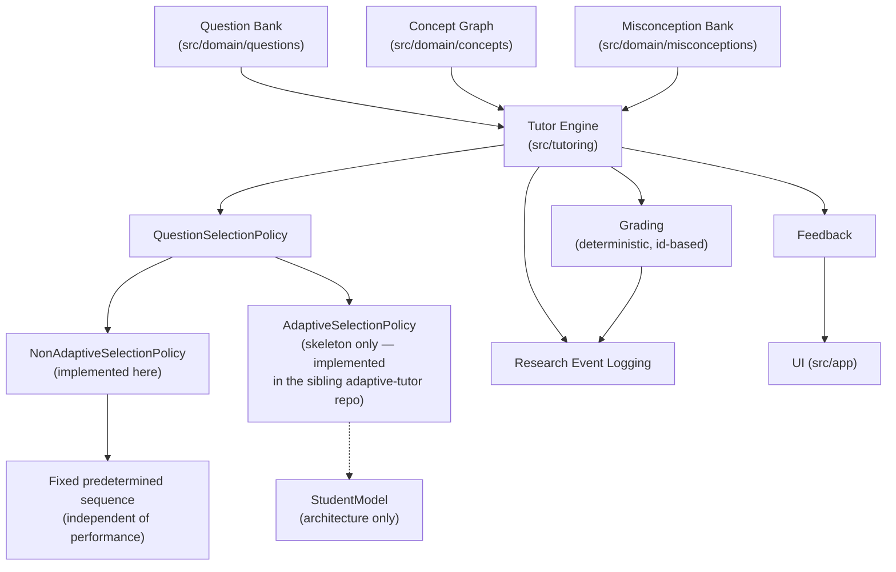

# Architecture

## Layering

```text
content        src/domain/{questions,concepts,misconceptions}
grading         src/tutoring/grading
student model   src/domain/student           (architecture only — Phase 0)
selection policy src/tutoring/selection/{nonAdaptive,adaptive}
feedback        src/tutoring/feedback
research logging src/research/{events,logging}
UI              src/app, src/components
```

Each layer only depends on the ones above it in this list — `src/app`
depends on `tutoring` and `research`, `tutoring` depends on `domain`, and
`domain` depends on nothing else in the project. Question selection is not
reachable from, or coupled to, any UI component; it is called through the
`QuestionSelectionPolicy` interface.



## Why the selection policy is a generic interface, not a shared object

```ts
interface QuestionSelectionPolicy<TContext> {
  readonly condition: ExperimentalCondition;
  selectNextQuestion(context: TContext): QuestionSelectionResult;
}
```

`TContext` is a type parameter, not a single shared "selection context"
shape, on purpose. `NonAdaptiveSelectionContext` and
`AdaptiveSelectionContext` are structurally different types:

- `NonAdaptiveSelectionContext` — participant id, a predetermined
  question-id sequence, and a position index. Nothing else.
- `AdaptiveSelectionContext` — participant id, available questions, a
  `StudentModel`, and answered-question history.

If both conditions shared one "god context" object containing every field
either policy might ever want, it would be possible (and, over time,
likely) for the non-adaptive policy to quietly start reading a mastery
field that happened to be sitting right there. Giving each policy its own
context type makes that a compile error instead of a code-review miss —
see [`experimental-conditions.md`](experimental-conditions.md) for the
enforcement argument in detail, and
`tests/tutoring/experimentalSeparation.test.ts` for the test that exercises
it.

## What's implemented vs. skeletal in this repository

This repository (`non-adaptive-tutor`) builds and validates the
**non-adaptive** condition end-to-end at the architecture level:
`NonAdaptiveSelectionPolicy` is fully implemented, `AdaptiveSelectionPolicy`
is an explicit skeleton that throws — present only so the shared
`QuestionSelectionPolicy` abstraction is visibly implementable by both
conditions and so tests can assert the separation compiles. The adaptive
condition's real mastery-driven logic is developed in a sibling repository
that shares this same domain-model shape.

## Concept graph (planned; not fully populated in Phase 0)

```text
Identifying quadratic expressions
        |
        v
   Expansion
        |
        v
  Factorisation
        |
        +-------------------+
        |                   |
        v                   v
Solving by factorisation   (quadratic graphs — future)
        |
        v
(completing the square — future)
        |
        v
  Quadratic formula
        |
        v
Discriminant / nature of roots
```

`src/domain/concepts/data.ts` currently populates the left-hand spine only
(5 concepts) — enough to validate the schema and referential integrity.
The full graph, including quadratic graphs and completing the square, is
built in a later phase.
