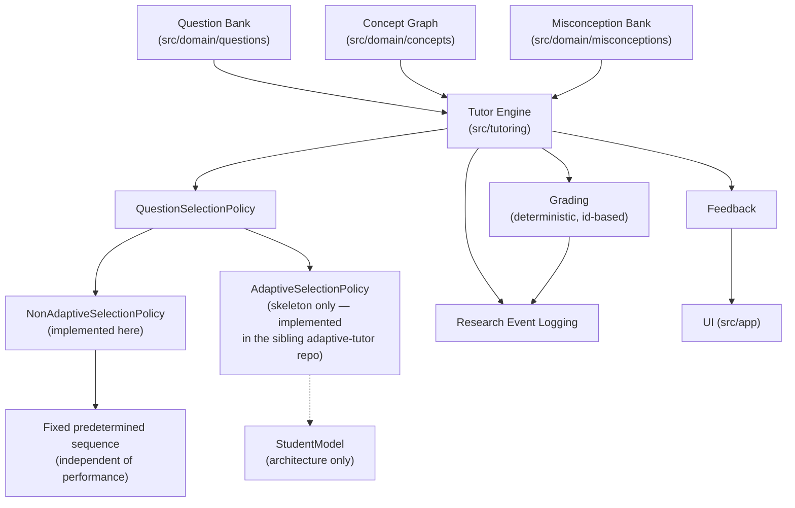

# Architecture

## Layering

```text
content            src/domain/{questions,concepts,misconceptions}
curriculum          src/domain/curriculum   (difficulty framework, ordering, cycle/graph validation, queries)
grading             src/tutoring/grading
student model       src/domain/student      (architecture only — Phase 0)
selection policy    src/tutoring/selection/{nonAdaptive,adaptive}
feedback            src/tutoring/feedback
research logging    src/research/{events,logging}
UI                  src/app, src/components
```

Each layer only depends on the ones above it in this list — `src/app`
depends on `tutoring` and `research`, `tutoring` depends on `domain`, and
`domain` depends on nothing else in the project. Question selection is not
reachable from, or coupled to, any UI component; it is called through the
`QuestionSelectionPolicy` interface.



## Why the selection policy is a generic interface, not a shared object

```ts
interface QuestionSelectionPolicy<TContext> {
  readonly condition: ExperimentalCondition;
  selectNextQuestion(context: TContext): QuestionSelectionResult;
}
```

`TContext` is a type parameter, not a single shared "selection context"
shape, on purpose. `NonAdaptiveSelectionContext` and
`AdaptiveSelectionContext` are structurally different types:

- `NonAdaptiveSelectionContext` — participant id, a predetermined
  question-id sequence, and a position index. Nothing else.
- `AdaptiveSelectionContext` — participant id, available questions, a
  `StudentModel`, and answered-question history.

If both conditions shared one "god context" object containing every field
either policy might ever want, it would be possible (and, over time,
likely) for the non-adaptive policy to quietly start reading a mastery
field that happened to be sitting right there. Giving each policy its own
context type makes that a compile error instead of a code-review miss —
see [`experimental-conditions.md`](experimental-conditions.md) for the
enforcement argument in detail, and
`tests/tutoring/experimentalSeparation.test.ts` for the test that exercises
it.

## What's implemented vs. skeletal in this repository

This repository (`non-adaptive-tutor`) builds and validates the
**non-adaptive** condition end-to-end at the architecture level:
`NonAdaptiveSelectionPolicy` is fully implemented, `AdaptiveSelectionPolicy`
is an explicit skeleton that throws — present only so the shared
`QuestionSelectionPolicy` abstraction is visibly implementable by both
conditions and so tests can assert the separation compiles. The adaptive
condition's real mastery-driven logic is developed in a sibling repository
that shares this same domain-model shape.

## Concept graph and curriculum module (Phase 1)

`src/domain/concepts/data.ts` populates the full 35-concept quadratics
graph across 9 strands — see [`docs/curriculum.md`](curriculum.md) for the
complete list, the branching prerequisite graph, and the coverage matrix.
`src/domain/curriculum/` holds the machinery that operates on that graph
without belonging inside the plain data files:

- `difficultyFramework.ts` — what each `DifficultyLevel` (1-5) means,
  independent of any one question (see
  [`docs/difficulty-framework.md`](difficulty-framework.md))
- `conceptDifficultyGuidance.ts` — which difficulty levels are appropriate
  per concept, for Phase 2 question authors
- `curriculumOrder.ts` — the recommended teaching sequence through the
  concept graph, distinct from the prerequisite graph itself (a
  prerequisite graph says what *can* precede what; this says what a
  reasonable sequence actually does)
- `queries.ts` — `getMisconceptionsForConcept`, `getConceptsByStrand`,
  `getPrerequisites`, `getDependents`
- `validateCurriculum.ts` — cycle detection over the prerequisite graph
  (`findConceptGraphCycles`), plus validators for the difficulty framework
  and the curriculum order, called from
  [`validateDomainModel`](../src/domain/validateDomainModel.ts) and from
  their own tests

## Production question bank (Phase 2)

`src/domain/questions/bank/` holds the 161-question production bank, one
file per strand, combined into a single `QUESTIONS` export by
`src/domain/questions/index.ts` (no other module should import a bank
file directly). Two more modules support it without belonging in the
plain data files, mirroring the `curriculum/` split above:

- `validateQuestionBank.ts` — Phase 2 quality gates beyond
  `validateDomainModel`'s general schema checks (non-empty stem/worked
  solution, no duplicate option text, every diagnostic distractor has a
  derivation note, difficulty within the concept's guidance range)
- `bankStatistics.ts` — coverage statistics and duplicate detection
  (stems, option sets, worked solutions), backing both
  `scripts/audit-questions.ts` (`npm run audit:questions`) and the test
  suite

Authored against the concept and misconception taxonomy per
[`docs/question-authoring-guide.md`](question-authoring-guide.md); see
[`docs/question-bank.md`](question-bank.md),
[`docs/question-bank-coverage.md`](question-bank-coverage.md), and
[`docs/question-bank-validation.md`](question-bank-validation.md) for the
bank itself.

## Session service and student UI (Phase 3)

`src/tutoring/session/` is where the running tutor's business rules
live — `service.ts`'s exported functions
(`startSession`/`getCurrentQuestion`/`submitAnswer`/`advanceSession`/
`getStudentFacingSummary`/`getResearchSummary`/`exportSession`/
`resetSession`) are the only way anything else in the application reads
or changes session state. It composes existing pieces rather than
reimplementing them: `NonAdaptiveSelectionPolicy` decides the next
question, `gradeAnswer` grades it, `buildFeedback` builds the feedback
text, and `ResearchEvent`s are logged through the existing
`InMemoryResearchEventLogger`. `publicViews.ts` is the one-way boundary
between this layer and the browser — see `docs/tutor-flow.md`, "What the
client never receives."

`src/app/tutor/` (the student UI) and `src/app/dev/session/` (a separate
development-only diagnostic view) both depend on `tutoring/session/`, and
`tutoring/session/` depends on `tutoring/selection`, `tutoring/grading`,
`tutoring/feedback`, and `research/`, never the reverse — the same
one-directional layering as the rest of the app (see "Layering" above).
React components never call `gradeAnswer`, the selection policy, or the
question bank directly.
