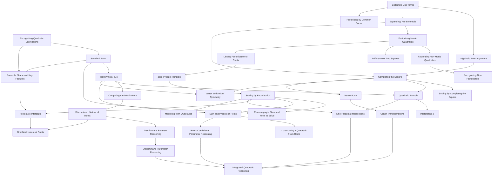

# Curriculum

The Phase 1 concept taxonomy for the Grade 9-10 quadratics domain:
[`src/domain/concepts/data.ts`](../src/domain/concepts/data.ts). 35 concepts
across 9 strands, with an explicit prerequisite graph
([`docs/architecture.md`](architecture.md) has the general system
architecture; this document is about curriculum content specifically).

## Scope

Grade 9-10 secondary-school algebra, scoped tightly to quadratic equations
and functions, but written to reach TMUA-style reasoning at the top of the
difficulty range (see [`difficulty-framework.md`](difficulty-framework.md)).
Concepts are kept small enough to be individually measurable ("the student
struggles with concept X") without fragmenting into every individual
algebraic step.

## Strands

| Strand | Concepts | Focus |
| --- | ---: | --- |
| `algebra_foundations` | 5 | Prerequisite algebra skills: recognising quadratics, standard form, expansion, rearrangement |
| `factorisation` | 6 | Factorising monic/non-monic quadratics, difference of two squares, linking factors to roots |
| `solving` | 8 | Zero-product principle, solving by factorisation/completing the square/formula |
| `discriminant` | 4 | Computing the discriminant, nature of roots, reverse and parameter reasoning |
| `roots_coefficients` | 3 | Sum/product of roots, constructing quadratics from roots, parameter reasoning |
| `graphs` | 4 | Parabola shape, x-intercepts, vertex/axis of symmetry, graphical root interpretation |
| `transformations` | 2 | Vertex form, translations/stretches/reflections |
| `intersections` | 2 | Line-parabola intersections, modelling with quadratics |
| `reasoning` | 1 | Integrated multi-concept, multi-step reasoning (the capstone) |

## Full concept list

| ID (suffix, `concept-` prefix omitted) | Name | Strand | Prerequisites |
| --- | --- | --- | --- |
| `recognising-quadratic-expressions` | Recognising Quadratic Expressions | algebra_foundations | — |
| `collecting-like-terms` | Collecting Like Terms | algebra_foundations | — |
| `standard-form` | Standard Form | algebra_foundations | recognising-quadratic-expressions |
| `algebraic-rearrangement` | Algebraic Rearrangement | algebra_foundations | collecting-like-terms |
| `expanding-two-binomials` | Expanding Two Binomials | algebra_foundations | collecting-like-terms |
| `factorising-common-factor` | Factorising by Common Factor | factorisation | collecting-like-terms |
| `factorising-monic-quadratics` | Factorising Monic Quadratics | factorisation | expanding-two-binomials |
| `factorising-non-monic-quadratics` | Factorising Non-Monic Quadratics | factorisation | factorising-monic-quadratics |
| `difference-of-two-squares` | Difference of Two Squares | factorisation | factorising-monic-quadratics |
| `recognising-non-factorisable` | Recognising Non-Factorisable Expressions | factorisation | factorising-non-monic-quadratics |
| `factorisation-roots-link` | Linking Factorisation to Roots | factorisation | factorising-monic-quadratics |
| `identifying-abc` | Identifying a, b, and c | solving | standard-form |
| `zero-product-principle` | The Zero-Product Principle | solving | factorisation-roots-link |
| `solving-by-factorisation` | Solving by Factorisation | solving | zero-product-principle |
| `rearranging-to-standard-form-to-solve` | Rearranging Into Standard Form Before Solving | solving | standard-form, solving-by-factorisation |
| `completing-the-square` | Completing the Square | solving | expanding-two-binomials, algebraic-rearrangement |
| `solving-by-completing-the-square` | Solving by Completing the Square | solving | completing-the-square |
| `quadratic-formula` | The Quadratic Formula | solving | completing-the-square, identifying-abc |
| `interpreting-plus-minus` | Correct Interpretation of ± | solving | quadratic-formula |
| `computing-discriminant` | Computing the Discriminant | discriminant | identifying-abc |
| `discriminant-nature-of-roots` | Nature of Roots From the Discriminant | discriminant | computing-discriminant |
| `discriminant-reverse-reasoning` | Reasoning Backwards From the Discriminant | discriminant | discriminant-nature-of-roots |
| `discriminant-parameter-reasoning` | Parameter Reasoning via the Discriminant | discriminant | discriminant-reverse-reasoning |
| `sum-and-product-of-roots` | Sum and Product of Roots | roots_coefficients | identifying-abc, solving-by-factorisation |
| `constructing-quadratic-from-roots` | Constructing a Quadratic From Given Roots | roots_coefficients | sum-and-product-of-roots |
| `roots-coefficients-parameter-reasoning` | Parameter Reasoning via Roots and Coefficients | roots_coefficients | sum-and-product-of-roots |
| `parabola-shape-and-key-features` | Parabola Shape and Key Features | graphs | recognising-quadratic-expressions, standard-form |
| `roots-as-x-intercepts` | Roots as x-Intercepts | graphs | solving-by-factorisation, parabola-shape-and-key-features |
| `vertex-and-axis-of-symmetry` | Vertex and Axis of Symmetry | graphs | identifying-abc, completing-the-square |
| `graphical-nature-of-roots` | Graphical Interpretation of the Nature of Roots | graphs | discriminant-nature-of-roots, roots-as-x-intercepts |
| `vertex-form` | Vertex Form | transformations | completing-the-square |
| `graph-transformations` | Graph Transformations | transformations | vertex-form |
| `line-parabola-intersections` | Line-Parabola Intersections | intersections | solving-by-factorisation, quadratic-formula |
| `modelling-with-quadratics` | Modelling With Quadratics | intersections | solving-by-factorisation |
| `integrated-quadratic-reasoning` | Integrated Quadratic Reasoning | reasoning | discriminant-parameter-reasoning, roots-coefficients-parameter-reasoning, graph-transformations, line-parabola-intersections |

Full descriptions and learning objectives are in
[`src/domain/concepts/data.ts`](../src/domain/concepts/data.ts) — this table
is for navigation, not the source of truth.

## Prerequisite graph

The graph branches — it is not one linear sequence. Two important chains:

```text
Expanding Two Binomials
        |
        v
Factorising Monic Quadratics
        |
        v
Linking Factorisation to Roots
        |
        v
Zero-Product Principle
        |
        v
Solving by Factorisation
        |
        +-------------------------+
        |                         |
        v                         v
Roots as x-Intercepts     Sum and Product of Roots
```

```text
Completing the Square
        |
        +-------------------+
        |                   |
        v                   v
Solving by Completing    Vertex Form
   the Square                |
        |                    v
        v              Graph Transformations
Quadratic Formula
        |
        v
Correct Interpretation of ±
```



## Recommended curriculum order

The prerequisite graph says what *can* come before what; it does not by
itself say what a reasonable teaching sequence *does*. That is
[`RECOMMENDED_CURRICULUM_ORDER`](../src/domain/curriculum/curriculumOrder.ts) —
a single total order consistent with the graph (validated by
`validateCurriculumOrder` — every prerequisite appears earlier than its
dependent), broadly:

```text
Foundations
  -> Factorisation
  -> Solving (factorisation, then completing the square, then the formula)
  -> Discriminant
  -> Roots and coefficients
  -> Graphs
  -> Transformations
  -> Intersections and modelling
  -> Integrated reasoning
```

This is a concept-level ordering, not the non-adaptive question-presentation
sequence — see
[`src/tutoring/selection/nonAdaptive/curriculumSequence.ts`](../src/tutoring/selection/nonAdaptive/curriculumSequence.ts)
for that (Phase 2 concern once the full question bank exists).

## Difficulty and misconceptions

See [`difficulty-framework.md`](difficulty-framework.md) for what each
difficulty level means and which levels each concept supports, and
[`misconception-taxonomy.md`](misconception-taxonomy.md) for the full
misconception list mapped to concepts.

## Coverage matrix

Generated from source data (concept, strand, difficulty guidance,
mapped misconceptions) — see
[`src/domain/curriculum/queries.ts`](../src/domain/curriculum/queries.ts)'s
`getMisconceptionsForConcept` for how the last column is computed.

| Concept | Strand | Difficulty | Misconceptions |
| --- | --- | ---: | --- |
| Recognising Quadratic Expressions | algebra_foundations | 1-2 | — |
| Collecting Like Terms | algebra_foundations | 1 | — |
| Standard Form | algebra_foundations | 1-2 | — |
| Algebraic Rearrangement | algebra_foundations | 1-3 | SIGN_ERROR_TRANSPOSE |
| Expanding Two Binomials | algebra_foundations | 1-3 | NEGATIVE_SQUARE_ERROR, DISTRIBUTION_ERROR, FOIL_TERM_OMITTED, SQUARE_OF_BINOMIAL_ERROR |
| Factorising by Common Factor | factorisation | 1-2 | — |
| Factorising Monic Quadratics | factorisation | 1-3 | FACTOR_SUM_PRODUCT_CONFUSION, FACTOR_SIGN_ERROR |
| Factorising Non-Monic Quadratics | factorisation | 2-4 | FACTOR_SUM_PRODUCT_CONFUSION, FACTOR_SIGN_ERROR, LEADING_COEFFICIENT_IGNORED |
| Difference of Two Squares | factorisation | 1-3 | DIFFERENCE_OF_SQUARES_MISAPPLIED |
| Recognising Non-Factorisable Expressions | factorisation | 2-4 | DIFFERENCE_OF_SQUARES_MISAPPLIED |
| Linking Factorisation to Roots | factorisation | 1-2 | — |
| Identifying a, b, and c | solving | 1-2 | NEGATIVE_COEFFICIENT_MISHANDLED, FORMULA_COEFFICIENT_SUBSTITUTION_ERROR |
| The Zero-Product Principle | solving | 1-2 | ZERO_PRODUCT_NOT_APPLIED, ONLY_ONE_FACTOR_SOLVED |
| Solving Quadratic Equations by Factorisation | solving | 1-3 | FACTOR_SIGN_ERROR, ZERO_PRODUCT_NOT_APPLIED, CONSTANT_TREATED_AS_ROOT, ONLY_ONE_FACTOR_SOLVED |
| Rearranging Into Standard Form Before Solving | solving | 2-4 | SIGN_ERROR_TRANSPOSE |
| Completing the Square | solving | 2-4 | NEGATIVE_SQUARE_ERROR, SQUARE_OF_BINOMIAL_ERROR, HALF_B_NOT_SQUARED, HALF_B_SIGN_ERROR, BALANCING_TERM_NOT_SUBTRACTED |
| Solving by Completing the Square | solving | 2-4 | PLUS_MINUS_DROPPED |
| The Quadratic Formula | solving | 2-4 | NEGATIVE_COEFFICIENT_MISHANDLED, NEGATIVE_B_DROPPED, PLUS_MINUS_DROPPED, DENOMINATOR_ONLY_APPLIED_TO_RADICAL, FORMULA_COEFFICIENT_SUBSTITUTION_ERROR |
| Correct Interpretation of ± | solving | 2-3 | PLUS_MINUS_DROPPED |
| Computing the Discriminant | discriminant | 1-2 | B_SQUARED_AS_2B, B2_PLUS_4AC |
| Nature of Roots From the Discriminant | discriminant | 2-3 | ROOT_COUNT_INTERPRETATION_REVERSED, ZERO_DISCRIMINANT_TWO_DISTINCT_ROOTS |
| Reasoning Backwards From the Discriminant | discriminant | 3-4 | — |
| Parameter Reasoning via the Discriminant | discriminant | 4-5 | — |
| Sum and Product of Roots | roots_coefficients | 2-3 | ROOT_SUM_SIGN_ERROR, ROOT_PRODUCT_SIGN_ERROR, ROOT_COEFFICIENT_CONFUSION |
| Constructing a Quadratic From Given Roots | roots_coefficients | 3-4 | ROOT_COEFFICIENT_CONFUSION |
| Parameter Reasoning via Roots and Coefficients | roots_coefficients | 4-5 | — |
| Parabola Shape and Key Features | graphs | 1-2 | ROOTS_CONFUSED_WITH_Y_INTERCEPT, PARABOLA_DIRECTION_ERROR |
| Roots as x-Intercepts | graphs | 2-3 | ROOTS_CONFUSED_WITH_Y_INTERCEPT, AXIS_OF_SYMMETRY_CONFUSED_WITH_ROOT |
| Vertex and Axis of Symmetry | graphs | 2-4 | VERTEX_X_COORDINATE_SIGN_ERROR, AXIS_OF_SYMMETRY_CONFUSED_WITH_ROOT |
| Graphical Interpretation of the Nature of Roots | graphs | 3-4 | — |
| Vertex Form | transformations | 2-3 | HORIZONTAL_TRANSLATION_DIRECTION_ERROR, VERTICAL_TRANSLATION_SIGN_ERROR |
| Graph Transformations | transformations | 3-4 | HORIZONTAL_TRANSLATION_DIRECTION_ERROR, VERTICAL_TRANSLATION_SIGN_ERROR, STRETCH_TRANSLATION_CONFUSION |
| Line-Parabola Intersections | intersections | 3-5 | — |
| Modelling With Quadratics | intersections | 3-5 | EXTRANEOUS_SOLUTION_NOT_REJECTED |
| Integrated Quadratic Reasoning | reasoning | 4-5 | — |

Several concepts (mostly foundational recognition skills, or higher-order
reverse/parameter-reasoning concepts) show no directly mapped
misconception. That is not an oversight: a foundational skill like
"Recognising Quadratic Expressions" is too basic for a dedicated flawed
*procedure* to be diagnostic (errors there are just "doesn't know the
definition"), and a higher-order concept like "Parameter Reasoning via the
Discriminant" produces wrong answers via the *lower-level* misconceptions
it builds on (e.g. `B2_PLUS_4AC`) rather than a new error pattern of its
own. Phase 2 question authors should still check
[`docs/question-authoring-guide.md`](question-authoring-guide.md) before
concluding a concept genuinely has no diagnostic distractor available.
