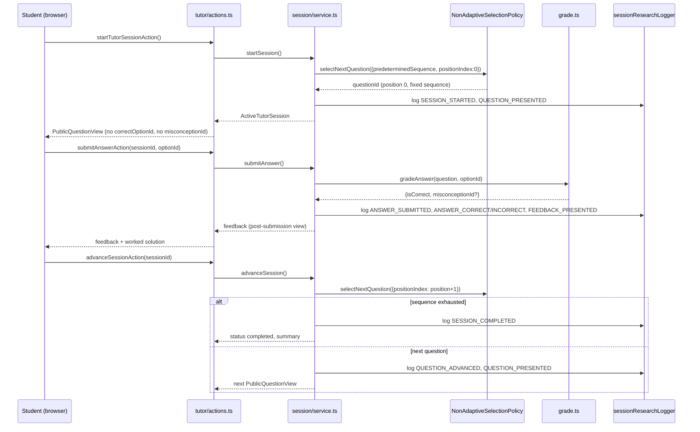
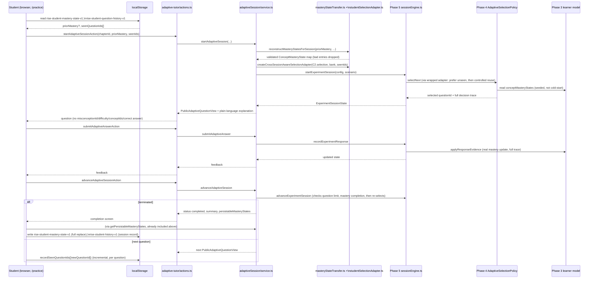

# Architecture and Data Flow

See [`AUDIT_INDEX.md`](AUDIT_INDEX.md) for the evidence-level legend.

## 1. Stack and entry points

**SOURCE VERIFIED** (`package.json`): Next.js 16.3.4 (Turbopack), React 19, TypeScript (strict), Tailwind CSS v4, Vitest 5, ESLint. Dependencies beyond the framework are minimal: `katex`/`@types/katex` (added in Phase 7 for LaTeX rendering) are the only non-dev runtime dependencies besides Next/React itself. No database driver, no auth library, no state-management library, no HTTP client library — consistent with CLAUDE.md's explicit "no production database, no authentication" scope statement.

Entry points:
- `src/app/layout.tsx` — root layout; injects a blocking inline theme script (`src/components/shell/themeScript.ts`) into `<head>` before hydration, and carries `suppressHydrationWarning` on `<html>` specifically because of that legitimate pre-hydration DOM mutation.
- `src/app/page.tsx` → `DashboardClient.tsx` — the Student Workspace home (`/`).
- `src/app/research/page.tsx` — the Researcher Workspace home (`/research`).
- Two legacy, still-live entry points outside the new Workspace shell: `src/app/tutor/page.tsx` (`/tutor`) and `src/app/adaptive-tutor/page.tsx` (`/adaptive-tutor`), each wrapped in the older `NavHeader` component instead of the new `AppShell`.

## 2. Two parallel UI shells

**SOURCE VERIFIED.** `src/components/shell/AppShell.tsx` is a sidebar-based shell with a Student/Researcher workspace switcher (`navConfig.ts`'s `STUDENT_NAV`/`RESEARCH_NAV`), breadcrumbs, and a theme toggle. It wraps: `/`, `/practice`, `/assessments`, `/progress`, `/history`, `/history/[id]`, `/settings`, and every `/research/*` page.

`src/components/NavHeader.tsx` is a much simpler top-nav bar with three static links (Home, Non-Adaptive Tutor, Adaptive Tutor). It wraps: `/tutor`, `/adaptive-tutor`, `/dev/session`, `/dev/adaptive-session`.

These are genuinely two different visual systems, not a client/server split of the same component — `AppShell.tsx`'s own doc comment (`src/components/shell/AppShell.tsx:21-30`) states this was a deliberate choice during the redesign ("to avoid touching working pages unnecessarily"), not an oversight. See `UI_UX_FUNCTIONAL_INVENTORY.md` and Finding F-08 for the consequences.

## 3. The two question banks and two curricula

**SOURCE VERIFIED**, this is the single most structurally significant fact about the codebase:

| | Non-adaptive (`/tutor`) | Adaptive (`/adaptive-tutor`, `/practice` adaptive mode) |
|---|---|---|
| Question source | `QUESTIONS` (`src/domain/questions/index.ts`) | `RISE_QUESTIONS` (`src/domain/rise/index.ts`) |
| Size | 161 questions | 1,840 questions |
| Concepts | 35, one domain (quadratic equations/functions), 9 strands | 109, 14 chapters spanning arithmetic through complex numbers, calculus, combinatorics |
| Authoring | Hand-authored, computationally verified per-question (`tests/domain/questionBank/mathVerification.test.ts`) | Externally generated; bank's own validation CSV marks every row `independent_human_review: not_performed`, `empirical_validation: not_performed` |
| Sequencing | One fixed, pre-computed 35-question sequence (`NON_ADAPTIVE_STUDY_SEQUENCE`) | Dynamically selected per response, from the full bank |
| Loaded from | Committed TypeScript literals, one file per strand | CSV files, parsed at module-init time (`src/domain/rise/csvParser.ts`) |

`docs/research-design.md:36-39` states: "Two tutoring conditions share the same question bank, grading, interface, explanations, scoring, session structure, and research logging. The one deliberate difference is whether question selection is allowed to use information about the student's performance." As built, only grading (`gradeAnswer`, genuinely shared) and the general interaction shape (MCQ, submit, feedback, continue) are actually shared. See Finding F-02.

## 4. Module map (by responsibility)

```mermaid
graph TB
    subgraph "Student-facing UI (src/app)"
        Dash["/  Dashboard\nDashboardClient.tsx"]
        Practice["/practice\nPracticeClient.tsx"]
        Assess["/assessments\nAssessmentsClient.tsx"]
        Progress["/progress\nProgressClient.tsx"]
        History["/history\nHistoryClient.tsx"]
        Settings["/settings\nSettingsClient.tsx"]
        Tutor["/tutor (legacy)\ntutor-client.tsx"]
        AdaptiveTutor["/adaptive-tutor (legacy)\nadaptive-tutor-client.tsx"]
    end

    subgraph "Researcher UI (src/app/research)"
        ResOverview["/research\nOverview"]
        ResExp["/research/experiments\nExperiment Designer"]
        ResModels["/research/models\nModel Comparisons"]
        ResResults["/research/results\nResults & Analytics"]
        ResRuns["/research/runs\nSimulation Runs"]
        ResRepro["/research/reproducibility"]
    end

    subgraph "Server Actions"
        TutorActions["src/app/tutor/actions.ts"]
        AdaptiveActions["src/app/adaptive-tutor/actions.ts"]
        ProgressActions["src/app/progress/actions.ts"]
    end

    subgraph "Non-adaptive engine"
        NASvc["src/tutoring/session/service.ts"]
        NAStore["sessionStore (in-memory Map)"]
        NALogger["sessionResearchLogger\n(InMemoryResearchEventLogger)"]
        NAPolicy["NonAdaptiveSelectionPolicy"]
        NASeq["NON_ADAPTIVE_STUDY_SEQUENCE\n(35 fixed questions)"]
        QBank["QUESTIONS\n(161, quadratics-only)"]
    end

    subgraph "Adaptive engine"
        AASvc["src/tutoring/adaptiveSession/service.ts"]
        AAStore["adaptiveSessionStore (in-memory Map)"]
        Phase5["Phase 5 session engine\nsrc/research/experiment/sessionEngine.ts"]
        Phase4["Phase 4 AdaptiveSelectionPolicy\nsrc/tutoring/selection/adaptive/"]
        Phase3["Phase 3 learner model\nsrc/domain/learner-model/"]
        RiseBank["RISE_QUESTIONS\n(1,840, 14 chapters)"]
        Cont["NEW: continuity layer\nmasteryStateTransfer.ts\nstudentSelectionAdapter.ts"]
    end

    subgraph "Client-side persistence (localStorage)"
        LSHistory["rise-student-history-v1"]
        LSMastery["rise-student-mastery-state-v1 (NEW)"]
        LSSeen["rise-student-question-history-v1 (NEW)"]
        LSSettings["rise-student-settings-v1"]
    end

    subgraph "Research pipeline (Phase 5-8)"
        Conditions["EXPERIMENT_CONDITIONS\nC0 / C1 / C2 / C3"]
        Artifact["Phase 6 artifact/export\nsrc/research/artifact/"]
        Phase8["Phase 8 simulator/estimators/\ntrackA, trackB, pilot"]
        PilotReport["pilot-report.json\n(docs/phase8/, research-output/)"]
    end

    Practice --> AdaptiveActions
    Practice --> TutorActions
    Tutor --> TutorActions
    AdaptiveTutor --> AdaptiveActions
    Assess -.deep link.-> Practice
    ProgressActions --> Phase3

    TutorActions --> NASvc
    NASvc --> NAStore
    NASvc --> NALogger
    NASvc --> NAPolicy
    NAPolicy --> NASeq
    NASvc --> QBank

    AdaptiveActions --> AASvc
    AASvc --> AAStore
    AASvc --> Phase5
    AASvc --> Cont
    Cont --> Conditions
    Phase5 --> Phase4
    Phase4 --> Phase3
    AASvc --> RiseBank

    Practice --> LSHistory
    Practice --> LSMastery
    Practice --> LSSeen
    Practice --> LSSettings
    LSMastery -.seeds next session.-> AdaptiveActions
    LSSeen -.seeds next session.-> AdaptiveActions

    Dash --> LSHistory
    Progress --> LSHistory
    History --> LSHistory
    Settings --> LSHistory

    Conditions --> Phase4
    Conditions --> Phase3
    Phase8 --> Conditions
    Phase8 --> PilotReport
    ResOverview --> PilotReport
    ResModels --> PilotReport
    ResResults --> PilotReport
    ResRuns --> PilotReport
    ResExp --> Phase8
    ResRepro --> Phase8
    Artifact -.not wired to Phase 8.-> Phase8
```

## 5. Non-adaptive session lifecycle (fully implemented, TEST VERIFIED)

## 6. Adaptive session lifecycle (as currently built, including the continuity fix)

**Important asymmetry, SOURCE VERIFIED:** the sequence above is `/practice`'s path. `/adaptive-tutor`'s own client (`adaptive-tutor-client.tsx`) calls `startAdaptiveSessionAction(selectedChapterId)` with no third/fourth argument (`adaptive-tutor-client.tsx:57`) and never reads or writes any of the three `localStorage` interactions shown above — it always cold-starts, and never appears in Session History/Dashboard/Progress. See Finding F-01.

## 7. Where "which question comes next" is actually decided

- **Non-adaptive:** `NonAdaptiveSelectionPolicy.selectNextQuestion` (`src/tutoring/selection/nonAdaptive/nonAdaptiveSelectionPolicy.ts:15-26`) — pure index lookup into `predeterminedSequence`. Cannot read performance data; the type it accepts (`NonAdaptiveSelectionContext`) has no field for it (`src/tutoring/selection/nonAdaptive/types.ts`). **SOURCE VERIFIED + TEST VERIFIED** (`performanceIndependence.test.ts`).
- **Adaptive:** `selectAdaptiveQuestion` (`src/tutoring/selection/adaptive/adaptiveSelectionPolicy.ts:67-120`), which calls, in order: `chooseTargetConcept` (which concept to target — progression/remediation/backtrack/diagnostic-probe), `chooseTargetDifficulty` (mastery-banded difficulty, with an anti-repetition nudge), `selectCandidateQuestion` (filters by concept → exposure → question-family-repetition → difficulty, then ranks by misconception overlap and difficulty-match, question id as the final deterministic tie-break). Full detail in `ADAPTIVE_ENGINE_DIAGNOSTICS.md`.
- **The continuity wrapper** (`studentSelectionAdapter.ts`) sits *outside* this — it only ever narrows or widens the `availableQuestions` array the above pipeline is allowed to choose from, before handing control to the unmodified pipeline. It never second-guesses a concept/difficulty decision.

## 8. Determinism inventory

| Decision | Deterministic? | Evidence |
|---|---|---|
| Non-adaptive next question | Yes, always | `NonAdaptiveSelectionPolicy` is a pure index lookup — SOURCE VERIFIED |
| Non-adaptive option display order | Yes, seeded by question id | `src/tutoring/session/optionOrder.ts`'s `seededShuffle` — SOURCE VERIFIED |
| Adaptive mastery update | Yes, pure function of (state, evidence, parameters) | `updateMastery`'s own doc comment: "Pure and deterministic" (`updateMastery.ts:62-64`) — SOURCE VERIFIED |
| Adaptive question selection | Yes, pure function of (context, config) | `chooseTargetConcept`'s own doc comment (`targeting.ts:208-211`); confirmed by this audit's own new test asserting two identically-seeded sessions pick the identical first question — SOURCE + TEST VERIFIED |
| Adaptive session *outcome* across different students | No — and this is intended | Mastery state legitimately diverges per real answers; "adaptive" means exactly this |
| Phase 8 simulated-learner responses | Seeded PRNG, not `Math.random` | `src/research/experiment/rng.ts`, `src/research/phase8/rng/derive.ts` exist as named modules for this — DOCUMENTED INTENT (not independently traced call-by-call in this audit) |
| Server timestamps (`new Date().toISOString()`) | Not deterministic, but never branched on for a selection/grading decision | Confirmed by reading every selection/grading function; timestamps are stored on traces/evidence records only — SOURCE VERIFIED |

## 9. Persistence architecture

See `SESSION_STATE_AND_PERSISTENCE.md` for full detail. Summary: **no database anywhere in this repository.** Server-side session state for both conditions is a plain in-memory `Map`, explicitly documented as process-lifetime-only (`src/tutoring/session/store.ts:4-11`, `src/tutoring/adaptiveSession/store.ts:3-12`). Student-facing persistence is entirely `localStorage`, under four keys (`rise-student-history-v1`, `rise-student-settings-v1`, and the two new continuity keys). Research data (Phase 6 artifacts, Phase 8 pilot reports) is flat JSON on disk under `research-output/` (gitignored) and `docs/phase8/` (committed snapshots).
