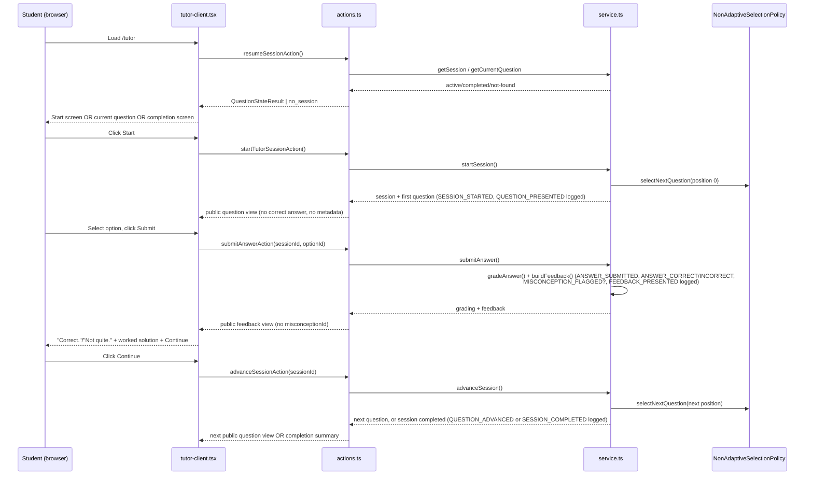

# Tutor Flow

How a student's session actually runs, end to end, and how the pieces fit
together. See [`docs/architecture.md`](architecture.md) for the broader
system layering; this document is specifically about the Phase 3
session lifecycle.

## Layering

```text
UI (Client Component)          src/app/tutor/tutor-client.tsx
        |
        v
Server Actions (thin)          src/app/tutor/actions.ts
        |
        v
Session service (business rules) src/tutoring/session/service.ts
        |
        +--> QuestionSelectionPolicy   src/tutoring/selection/nonAdaptive/nonAdaptiveSelectionPolicy.ts
        +--> gradeAnswer                src/tutoring/grading/grade.ts
        +--> buildFeedback              src/tutoring/feedback/feedback.ts
        +--> research event logging     src/tutoring/session/store.ts (sessionResearchLogger)
```

`tutor-client.tsx` never imports the selection policy, `gradeAnswer`, or
the question bank directly — it only calls the four Server Actions and
renders whatever they return. Every business rule (what question comes
next, whether an answer is correct, what feedback to show, what gets
logged) lives in `service.ts` and the modules it calls, which is what
makes constraint 4 in `CLAUDE.md` (no performance-based branching)
actually enforceable rather than just a UI convention.



## Step by step

1. **Load `/tutor`.** `page.tsx` is a thin Server Component rendering
   `<TutorClient />`; all state comes from the client's own effect.
2. **Resume check.** On mount, `TutorClient` calls `resumeSessionAction()`,
   which reads the `tutorSessionId` cookie server-side. No cookie, or a
   cookie pointing at a session the in-memory store no longer has (e.g.
   after a dev-server restart) → `{ status: "no_session" }`, and the
   client shows the start screen.
3. **Start.** Clicking Start calls `startTutorSessionAction()`, which
   calls `service.startSession()`. That function builds a fresh
   `ActiveTutorSession` on `NON_ADAPTIVE_STUDY_SEQUENCE`, logs
   `SESSION_STARTED`, asks `NonAdaptiveSelectionPolicy` for the question
   at position 0, logs `QUESTION_PRESENTED`, and stores the session.
   `startTutorSessionAction` sets the `tutorSessionId` cookie so the
   browser can find this session again on refresh.
4. **Present.** The action strips the question down to
   `PublicQuestionView` (`src/tutoring/session/publicViews.ts`) — stem and
   `{id, display}` options only — before it ever reaches the client. See
   "What the client never receives" below.
5. **Answer.** The student picks one radio option; Submit is disabled
   until one is selected. Submitting calls `submitAnswerAction`, which
   calls `service.submitAnswer()`: validates the session is active and
   this position hasn't already been answered, grades via the existing
   deterministic `gradeAnswer`, builds feedback via the existing
   `buildFeedback`, records a `TutorResponse`, and logs
   `ANSWER_SUBMITTED` → `ANSWER_CORRECT`/`ANSWER_INCORRECT` →
   (`MISCONCEPTION_FLAGGED` if the selected option carries one) →
   `FEEDBACK_PRESENTED`.
6. **Feedback.** The action maps the result to `PublicFeedbackView` —
   correctness, the correct option's display text, the explanation, the
   worked solution. `misconceptionId` and `derivationNote` never leave
   the server (see `CLAUDE.md` constraint 3/7). The UI locks the option
   list (the `<fieldset>` becomes `disabled`) and shows Continue instead
   of Submit.
7. **Continue.** Calls `advanceSessionAction`, which calls
   `service.advanceSession()`. This asks `NonAdaptiveSelectionPolicy` for
   the question at `currentPosition + 1` — never by inspecting
   `responses` — logs `QUESTION_ADVANCED`, and presents it (logging
   `QUESTION_PRESENTED` again). If the sequence is exhausted instead, it
   completes the session (`SESSION_COMPLETED`) and returns
   `{ status: "completed", summary }`.
8. **Completion.** The client shows total correct, total questions, and
   accuracy — nothing else (see `docs/session-data-schema.md` for the
   richer `ResearchSessionSummary` that exists but is never sent to this
   screen).

## What the client never receives

Not "rendered but hidden" — never present in the Server Action's
response at all, so it can't be found by inspecting network traffic or
page source either:

- `misconceptionId` / `derivationNote` on any option, ever
- `correctOptionId` or which option is correct, before submission
- `difficulty`, `conceptIds`, `primaryConceptId`
- the experimental condition, session internals, or any selection-policy
  detail

See `src/tutoring/session/publicViews.ts` for the two mapping functions
(`toPublicQuestionView`, `toPublicFeedbackView`) that enforce this.

## Option display order

Verified empirically during Phase 3 end-to-end testing (not by
inspection alone): every question in the production bank was authored
with its correct option listed first. Left unshuffled, that made "always
pick the first radio button" a genuine 100%-accuracy strategy across the
whole bank. `toPublicQuestionView` now applies a deterministic shuffle
seeded only by `questionId` (`src/tutoring/session/optionOrder.ts`) — the
same question always displays in the same order for every participant,
every time, but that order is no longer always "correct answer first."
Grading is unaffected either way, since `gradeAnswer` has only ever
compared by option `id`.

## Guards against invalid states

`src/tutoring/session/errors.ts` defines typed errors for every invalid
transition the spec calls out: session not found, already completed,
answer already submitted for this position, Continue pressed before
submitting, an option id that doesn't belong to the current question, and
an out-of-range sequence position. `actions.ts` catches all of these (and
anything unexpected) and returns `{ ok: false, error: "..." }` rather
than letting a stack trace reach the client — see `errorMessage()` in
`src/app/tutor/actions.ts`.

## Resume behaviour and its limitation

Session state lives in a server-process-lifetime in-memory store
(`src/tutoring/session/store.ts`) — see
[`docs/research-logging.md`](research-logging.md) for why, and its
limitation (lost on server restart, not on refresh/navigation). The
`tutorSessionId` cookie is what lets a page refresh — or closing and
reopening the tab — find the same session again: `resumeSessionAction`
rebuilds the exact same view the student was looking at, including
already-submitted feedback (via
`toPublicFeedbackViewFromResponse`, which reconstructs the feedback from
the stored `TutorResponse` rather than re-grading).

## Development-only debug view

`/dev/session` (`src/app/dev/session/`) is a separate route, never linked
from `/tutor`, that shows the *full* internal session state, response
records, and event log for whichever session the current browser's cookie
points at, plus buttons to download the full JSON export or reset the
session. See [`docs/session-data-schema.md`](session-data-schema.md) for
the export's shape.
