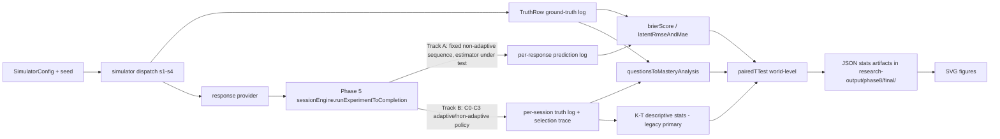

# 02. System Architecture

Evidence-grounded reconstruction, not a design-document restatement. Labels: VERIFIED — SOURCE unless noted.

## Layers (as actually implemented)

1. **Presentation** — Next.js App Router, React. Canonical student route `src/app/practice/PracticeClient.tsx` (both adaptive and non-adaptive modes, mode/chapter selectors). Legacy routes `src/app/tutor/`, `src/app/adaptive-tutor/` retained with compatibility banners (per prior Stage 3 work — SOURCE PRESENT, not re-verified in a browser by this audit pass; see file 14 for the reproducibility distinction this implies). Math rendering via a KaTeX component (`src/components/MathText.tsx`, referenced from prior-stage reports — not opened in this pass).
2. **Application/orchestration** — `src/tutoring/adaptiveSession/service.ts` (adaptive condition orchestration), `src/tutoring/nonAdaptiveRiseSession/` (non-adaptive-on-RISE orchestration), both built as thin wrappers over the shared Phase 5 engine (`src/research/experiment/sessionEngine.ts`) rather than separate implementations (VERIFIED — SOURCE import structure).
3. **Knowledge representation** — RISE bank loaders under `src/domain/rise/` (`RISE_QUESTIONS`, `RISE_CONCEPTS`, `RISE_MISCONCEPTIONS`), sourced from `data/question-bank/*.csv`. Prerequisite graph in `data/question-bank/prerequisite-edges-v1.csv` (204 edges, VERIFIED by direct line count).
4. **Mastery estimation** — `src/domain/learner-model/updateMastery.ts` + `parameters.ts` (see file 04 for exact equations). `applyResponseEvidence` fans one response out across every concept named in that question's `conceptWeights`; concepts not in that map (including a question's own prerequisites) are never touched by a single answer — this is an explicit design choice in the code comment, not an oversight.
5. **Question selection** — `src/tutoring/selection/adaptive/` (adaptive policy; not re-opened line-by-line in this pass — see file 05 for what was verified) and the non-adaptive RISE sequence builder (`src/tutoring/selection/nonAdaptive/riseSequence.ts`, referenced by Stage 1's own report; not re-opened here).
6. **Simulation** — `src/research/phase8/simulator/{s1,s2,s3,s4}.ts`, dispatched via `dispatch.ts`. See file 06.
7. **Experimental evaluation** — `src/research/experiment/conditions.ts` (C0-C3 registry), `sessionEngine.ts` (shared run loop), Track A runner (`src/research/phase8/trackA/`, not opened directly this pass) and Track B runner (`src/research/phase8/trackB/runTrackB.ts`, opened — see files 10 and 12).
8. **Reproducibility/artifact** — Phase 6 artifact builder (`src/research/artifact/`), SQLite session store (`src/research/storage/`, per Stage 2's report — not re-opened this pass), `src/research/phase8/metrics/threeMetrics.ts` (new, opened and verified — file 08).

## Data flow (simulation → metrics), as implemented

**Important structural fact (VERIFIED — SOURCE, `threeMetrics.ts` header comment):** the unit of statistical independence throughout is the **world**, not the response and not the individual simulated learner — because learners sharing a world share item noise draws and concept parameters. All p-values in this repository's artifacts are world-level paired tests with n = number of worlds (5 in the existing pilot), never response-level or learner-level n.

## What this audit did not re-trace in full

The adaptive selection policy's internal branch logic (progression/remediation/diagnostic-backtracking decision tree), the Phase 6 artifact hashing scheme, and the SQLite persistence schema were not re-opened file-by-line in this pass; they are reported in files 05/13/14 at the confidence level of "prior-stage source presence confirmed to exist, not independently re-derived here." This is stated explicitly rather than implied as exhaustive.
