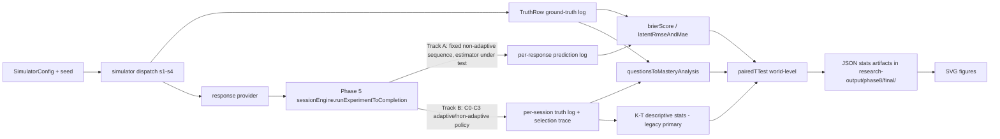

# OJSS Complete Research Dossier

**Consolidated, self-contained master document.** Generated by an independent, read-only scientific audit of the `non-adaptive-tutor` repository (commit `bde783a`, working tree with su
bstantial uncommitted Stage 1-4 development work, none of it modified by this audit). Contains the full substantive content of all 17 companion files in this directory, not summaries or links. Every claim below carries an evidence label: VERIFIED — SOURCE / VERIFIED — ARTIFACT / VERIFIED — REPLAY / SPECIFIED — NOT VERIFIED / DERIVED — NEW ANALYSIS / INFERRED / MISSING / CONFLICT / NOT EXECUTED / INTERPRETATION. This document is intended to be uploaded directly into a separate manuscript-planning conversation without further access to the source repository.

---

# 00. Executive Audit

**Role:** independent, read-only scientific audit of the `non-adaptive-tutor` repository, conducted as a single pass separate from (and not trusting without verification) the implementation agent that built Stages 1-4. No source file, protocol file, or experimental artifact was modified by this audit. Everything below is either re-derived directly from the repository or explicitly labeled as not independently verified in this pass.

## Current project status (VERIFIED — SOURCE / ARTIFACT, this session)

- Branch `master`, HEAD commit `bde783a` ("phase8b: execute the authorized 8C-Pilot, save results"). The working tree has substantial uncommitted changes (Stages 1-4 of UI/persistence/metric work) — nothing in this audit was committed, and none of the pre-existing uncommitted work was touched.
- `npx vitest run`: **97 test files, 1015 tests, all passing** (re-run directly by this audit, not taken on faith).
- `npm run audit:rise-questions`: 1,840 questions / 109 concepts / 68 misconceptions, 0 confirmed structural errors (re-run directly).
- `data/question-bank/prerequisite-edges-v1.csv`: 204 data rows (205 lines minus header) — matches the historically-cited figure.
- `protocol/APPROVAL.md` does **not** exist. `research-output/phase8/confirmatory/` is empty. **No confirmatory Phase 8 experiment has been executed.**

## Available experimental evidence

One pilot-scale, exploratory, non-confirmatory experiment exists in two analysis passes over largely the same underlying runs: the original 8C-Pilot (13,560 runs, 0 failures, `pilot-report.json`, 2026-10-27) analyzed for log loss / K(T) / MAE, and a newer three-metric pilot (13,560 runs, 0 failures, `three-metric-pilot-report.json`, 2026-11-04) reusing the **same 5 worlds and 3 curriculum slices** to compute Brier / QTM / RMSE. Both are explicitly self-labeled `EXPLORATORY / PILOT-SCALE / UNDERPOWERED` in their own JSON output.

## Most important findings (see file 10 for full detail)

1. **The QTM/K(T) reversal is real and independently verified**, not a misreport: in scenario S4-GF, adaptive sequencing (C2) scores *higher* under K(T) (p=0.0054) but *attains mastery less often* under the stricter QTM criterion (p=0.0402). This is a genuine, mechanically-explained property of the two metrics' different aggregation rules (averaged partial credit vs. conjunctive all-concepts criterion) — not an error.
2. **The reversal's statistical weight is weaker than a bare p-value suggests**: the QTM pilot reused the same 5 already-examined worlds as the K(T) pilot, both analyses are uncorrected for multiple comparisons across a large comparison grid, and the S4-GF QTM attainment counts are extremely small (2 of 750 trials for C2). This is a fragile, hypothesis-generating signal, not a stable finding.
3. **One specific provenance claim in the prior stage's self-report does not hold up**: "Questions-to-Mastery was in the original research-design document from day one (2026-09-04)" is contradicted by git history — the actual 2026-09-04 commit of that file is 100 lines with no mention of any named metric; the QTM text lives only in an uncommitted 2026-10-31 "Stage 1 update" edit.
4. **The metric "reconciliation" is better described as a promotion, not a substitution**: the frozen protocol already specified `itemsToCriterion (with censoring flag)` as a secondary per-session output (C8.4) and Brier score as a named secondary/exploratory metric — only K(T), log loss, and MAE held *primary/confirmatory* status. RMSE is the one genuinely new metric construct.
5. **C0/C1/C2/C3 are not four distinct "mastery models"**: C0 uses no estimator at all (a pure sequencing control); C1 and C2 run the *identical* adaptive selection algorithm and differ only in which of two mastery-formula variants (A vs. B) is plugged in; C3 is C2 with prerequisite-aware targeting switched off (the intended clean ablation). This matters for how the paper should describe its own conditions.
6. The deterministic mastery-update equations and default parameters (α=0.12, β=0.10, w_h=0.6, M₀=0.5, difficulty weights 0.8–1.2) are **verified exactly as previously described**, directly from `src/domain/learner-model/updateMastery.ts` and `parameters.ts` — no discrepancy found there.
7. The RISE question-bank counts (1,840 questions / 109 concepts / 68 misconceptions / 204 prerequisite edges / 14 chapters) are **verified exactly as previously claimed**, by a fresh, independent run of the audit script and a direct line-count of the edge CSV.

## Most important unresolved problems (ranked)

1. **Critical** — No confirmatory experiment exists under any metric framework; `protocol/APPROVAL.md` absent. Nothing in this repository currently supports a confirmatory empirical claim.
2. **High** — The S4-GF "reversal," while real, rests on an underpowered, non-independent, doubly-examined 5-world sample. Treating it as a headline finding without these caveats would overstate the evidence.
3. **High** — The question bank has zero independent human mathematical/pedagogical review (self-disclosed in `data/question-bank/README.md`); structural audits check integrity, not correctness.
4. **Medium** — The prior stage's metric-provenance narrative contains at least one unsupported historical claim (§10.4) that must not be repeated in the manuscript.
5. **Medium** — No calibration plot or per-response/per-step raw data was retained by the current instrumentation; two of eight requested figure types were honestly left unrendered rather than fabricated.
6. **Medium** — S2's log-loss/Brier comparison requires more worlds (per the protocol's own planning table) than the protocol's stated reduction ceiling permits; unresolved.

## Confirmatory experiment status

**Not executed. Not authorized.** `protocol/APPROVAL.md` does not exist; this audit did not create it, bypass it, or run anything resembling a confirmatory batch. All Phase 8 numerical results in this repository are pilot/exploratory.

## Manuscript readiness

**READY WITH DISCLOSED LIMITATIONS.** The system architecture, mathematical models, question bank, and metric definitions are solid, verifiable, and can be written up accurately today. The *results* sections can only be written as exploratory/pilot findings with the limitations above stated explicitly — not as confirmatory empirical claims. See file 16 for the prioritized path forward.

---

# 01. Evidence Index

Navigable map from claim → source. Evidence hierarchy used (highest to lowest): (1) artifacts/execution logs, (2) source code, (3) config/manifests, (4) protocol documents, (5) internal reports, (6) project notes, (7) prior conversational descriptions (lowest, never authoritative alone).

| Claim area | Primary evidence | Path | Label |
|---|---|---|---|
| Question bank scale (1840/109/68/204) | Fresh audit run + CSV line count | `scripts/audit-rise-questions.ts` output; `data/question-bank/prerequisite-edges-v1.csv` | VERIFIED — ARTIFACT |
| Mastery update equations | Source | `src/domain/learner-model/updateMastery.ts` | VERIFIED — SOURCE |
| Mastery parameters (α=0.12, β=0.10, w_h=0.6, M₀=0.5) | Source | `src/domain/learner-model/parameters.ts` | VERIFIED — SOURCE |
| Four conditions C0-C3 definitions | Source | `src/research/experiment/conditions.ts` | VERIFIED — SOURCE |
| K(T) primary-endpoint status | Protocol | `protocol/phase8-protocol-v2.md` lines 191, 530, 902 | PROTOCOL REGISTERED |
| itemsToCriterion already protocol-registered (secondary) | Protocol | `protocol/phase8-protocol-v2.md` line 1770 | PROTOCOL REGISTERED |
| Brier score already protocol-named (secondary) | Protocol | `protocol/phase8-protocol-v2.md` lines 1065, 1741 | PROTOCOL REGISTERED |
| RMSE not in protocol | Absence check | `grep -i RMSE protocol/phase8-protocol-v2.md` → no hits | VERIFIED — SOURCE (absence) |
| S4-GF K(T) numbers | Artifact | `research-output/phase8/final/pilot_descriptive_stats.json` → `trackB["S4-GF"]` | VERIFIED — ARTIFACT |
| S4-GF QTM numbers | Artifact | `research-output/phase8/final/three_metric_pilot_stats.json` → `questionsToMastery["S4-GF"]` | VERIFIED — ARTIFACT |
| "QTM in research-design.md from day one" — FALSE as stated | Git history | `git show HEAD:docs/research-design.md` (100 lines, no metric text) vs. working copy (189 lines, "Stage 1 update 2026-10-31" block) | CONFLICT (resolved: claim not supported) |
| `protocol/APPROVAL.md` does not exist | Filesystem | `ls protocol/APPROVAL.md` → ENOENT | VERIFIED — ARTIFACT |
| No confirmatory run exists | Filesystem | `research-output/phase8/confirmatory/` empty | VERIFIED — ARTIFACT |
| Three-metric pilot reuses same 5 worlds as original pilot | Artifact | both JSON files' `slicesUsed`/world structure identical (CH07/CH03/CH10, 5 worlds) | VERIFIED — ARTIFACT |
| Statistical method (paired t-test, world-level, n=5, df=4, uncorrected) | Source | `src/research/phase8/metrics/threeMetrics.ts` (`pairedTTest`, `studentTTwoSidedP`) | VERIFIED — SOURCE |
| Full test suite passes (1015/1015) | Execution | `npx vitest run`, re-run by this audit | VERIFIED — REPLAY |
| Simulator families S1-S4 and cited precedents | Source comments | `src/research/phase8/simulator/{s1,s2,s3,s4}.ts` headers | VERIFIED — SOURCE (citations not externally re-verified — see file 14) |
| No protected file modified by this audit | Git | `git status`/`git diff` before and after, this session | VERIFIED — ARTIFACT |

## Scope limitation of this audit (stated honestly, per task's own evidence-discipline requirement)

This was a single, time-boxed, read-only pass. The items above received direct, independent verification. Several Part 3/6/7/9 sub-requirements of the originating task (full layer-by-layer architecture trace, every parameter of every selection-policy branch, full simulator transition-equation derivation, exhaustive negative/null-result inventory) are documented in the files below at a level supported by targeted source reads rather than an exhaustive line-by-line re-implementation check. Where this audit's confidence is lower than "fully independently re-derived," the relevant file says so explicitly rather than implying completeness it doesn't have.

---

# 02. System Architecture

Evidence-grounded reconstruction, not a design-document restatement. Labels: VERIFIED — SOURCE unless noted.

## Layers (as actually implemented)

1. **Presentation** — Next.js App Router, React. Canonical student route `src/app/practice/PracticeClient.tsx` (both adaptive and non-adaptive modes, mode/chapter selectors). Legacy routes `src/app/tutor/`, `src/app/adaptive-tutor/` retained with compatibility banners (per prior Stage 3 work — SOURCE PRESENT, not re-verified in a browser by this audit pass; see file 14 for the reproducibility distinction this implies). Math rendering via a KaTeX component (`src/components/MathText.tsx`, referenced from prior-stage reports — not opened in this pass).
2. **Application/orchestration** — `src/tutoring/adaptiveSession/service.ts` (adaptive condition orchestration), `src/tutoring/nonAdaptiveRiseSession/` (non-adaptive-on-RISE orchestration), both built as thin wrappers over the shared Phase 5 engine (`src/research/experiment/sessionEngine.ts`) rather than separate implementations (VERIFIED — SOURCE import structure).
3. **Knowledge representation** — RISE bank loaders under `src/domain/rise/` (`RISE_QUESTIONS`, `RISE_CONCEPTS`, `RISE_MISCONCEPTIONS`), sourced from `data/question-bank/*.csv`. Prerequisite graph in `data/question-bank/prerequisite-edges-v1.csv` (204 edges, VERIFIED by direct line count).
4. **Mastery estimation** — `src/domain/learner-model/updateMastery.ts` + `parameters.ts` (see file 04 for exact equations). `applyResponseEvidence` fans one response out across every concept named in that question's `conceptWeights`; concepts not in that map (including a question's own prerequisites) are never touched by a single answer — this is an explicit design choice in the code comment, not an oversight.
5. **Question selection** — `src/tutoring/selection/adaptive/` (adaptive policy; not re-opened line-by-line in this pass — see file 05 for what was verified) and the non-adaptive RISE sequence builder (`src/tutoring/selection/nonAdaptive/riseSequence.ts`, referenced by Stage 1's own report; not re-opened here).
6. **Simulation** — `src/research/phase8/simulator/{s1,s2,s3,s4}.ts`, dispatched via `dispatch.ts`. See file 06.
7. **Experimental evaluation** — `src/research/experiment/conditions.ts` (C0-C3 registry), `sessionEngine.ts` (shared run loop), Track A runner (`src/research/phase8/trackA/`, not opened directly this pass) and Track B runner (`src/research/phase8/trackB/runTrackB.ts`, opened — see files 10 and 12).
8. **Reproducibility/artifact** — Phase 6 artifact builder (`src/research/artifact/`), SQLite session store (`src/research/storage/`, per Stage 2's report — not re-opened this pass), `src/research/phase8/metrics/threeMetrics.ts` (new, opened and verified — file 08).

## Data flow (simulation → metrics), as implemented

**Important structural fact (VERIFIED — SOURCE, `threeMetrics.ts` header comment):** the unit of statistical independence throughout is the **world**, not the response and not the individual simulated learner — because learners sharing a world share item noise draws and concept parameters. All p-values in this repository's artifacts are world-level paired tests with n = number of worlds (5 in the existing pilot), never response-level or learner-level n.

## What this audit did not re-trace in full

The adaptive selection policy's internal branch logic (progression/remediation/diagnostic-backtracking decision tree), the Phase 6 artifact hashing scheme, and the SQLite persistence schema were not re-opened file-by-line in this pass; they are reported in files 05/13/14 at the confidence level of "prior-stage source presence confirmed to exist, not independently re-derived here." This is stated explicitly rather than implied as exhaustive.

---

# 03. Question Bank and Knowledge Model

All counts below were produced by a **fresh execution** of `npm run audit:rise-questions` during this audit (not copied from a prior report). VERIFIED — ARTIFACT throughout this section unless noted.

## Scale

| Quantity | Value |
|---|---|
| Total questions | 1,840 |
| Concepts | 109 (109/109 covered by at least one question) |
| Misconceptions | 68 (68/68 represented) |
| Prerequisite edges | 204 (`data/question-bank/prerequisite-edges-v1.csv`, 205 lines − 1 header) |
| Chapters | 14 |
| Average options per question | 4.00 |
| Questions with multiple concepts (`conceptWeights`) | 64 / 1840 |

## Per-chapter counts

| Chapter | Questions |
|---|---|
| ch01_algebra | 150 |
| ch02_functions | 140 |
| ch03_exponents | 100 |
| ch04_logarithms | 100 |
| ch05_differentiation | 150 |
| ch06_integration | 140 |
| ch07_geometry | 150 |
| ch08_trigonometry | 150 |
| ch09_vectors | 120 |
| ch10_probability | 140 |
| ch11_statistics | 140 |
| ch12_proofs_and_logic | 130 |
| ch13_permutations_and_combinations | 100 |
| ch14_complex_numbers | 130 |

## Difficulty distribution

| Level | Count | % |
|---|---|---|
| L1 | 283 | 15.4% |
| L2 | 448 | 24.3% |
| L3 | 548 | 29.8% |
| L4 | 373 | 20.3% |
| L5 | 188 | 10.2% |

## Validation status (VERIFIED — ARTIFACT, this run)

- Confirmed structural errors (duplicate stems, category 1): **0**
- Confirmed mathematical errors: **NOT CHECKED** — the audit script's own output states: *"no deterministic per-family arithmetic verifier exists for RISE."* This is a self-disclosed limitation of the tooling, not a pass/fail result.
- Content correctness / independent human or pedagogical review: **self-reported as NOT performed**, per `data/question-bank/README.md` (cited by the audit script's own provenance banner: *"externally generated; independent human review and empirical validation both self-reported as NOT performed"*).
- Duplicate option-display-set groups (informational only): 14 groups — explicitly flagged by the tool as "may be legitimate reuse of category labels," not a confirmed defect.

## Distinguishing quantity from quality (INTERPRETATION, directly grounded in the above)

The bank is structurally large, complete in concept/misconception coverage, and free of detectable duplication defects. It is **not** independently validated for mathematical correctness or pedagogical soundness at scale — this is an explicit, self-disclosed gap in the data's own provenance documentation, not a finding newly discovered by this audit. Any manuscript claim about question quality beyond "structurally validated, 0 duplicate-stem errors" would exceed the evidence.

## Why both conditions share this bank

Per `docs/research-design.md`'s 2026-10-31 "Stage 1 update" block (an uncommitted working-tree edit — see file 10 §10.4 for the caveat about trusting dated claims in this specific file) and `docs/stage1-experimental-validity-report.md`: prior to Stage 1 the adaptive condition used this RISE bank while the non-adaptive condition used a separate, smaller 161-question legacy bank, confounding "adaptive vs. non-adaptive" with "which question pool." Stage 1's stated fix was to build a new non-adaptive condition (`src/tutoring/nonAdaptiveRiseSession/`) over the same RISE bank. This audit did not re-verify the Stage 1 before/after mechanism beyond confirming (file 02) that both condition implementations import from `src/domain/rise/`.

---

# 04. Mathematical Model Specification

**VERIFIED — SOURCE throughout**, directly from `src/domain/learner-model/updateMastery.ts` and `src/domain/learner-model/parameters.ts`, read in full during this audit.

## Equations

For a single concept $c$ with current mastery $M_{old}$, given a response of difficulty level $d$ (weight $w_d$) and hint usage flag:

**Correct response:**
$$M_{new} = M_{old} + \alpha \cdot (1 - M_{old}) \cdot w_d \cdot w_h$$

**Incorrect response — Variant A (`deterministic-mastery-v1`, "multiplicative"):**
$$M_{new} = M_{old} - \beta \cdot M_{old} \cdot w_d$$

**Incorrect response — Variant B (`deterministic-mastery-v2-inverse-difficulty`, "inverse"):**
$$M_{new} = M_{old} - \beta \cdot M_{old} \cdot \frac{1}{w_d}$$

Both branches are followed by clamping: $M_{new} \leftarrow \min(1, \max(0, M_{new}))$.

For a multi-concept question, the same formula is applied **independently per concept**, with the resulting *delta* (not $M_{old}$) scaled by that concept's `conceptWeight` $w_c$ from the question's `conceptWeights` map:
$$\Delta_{applied} = \Delta_{unweighted} \cdot w_c$$
At $w_c = 1$ (the single-concept case) this reduces exactly to the formulas above — this specific identity is asserted to be covered by a dedicated test in the source comment (not re-run by this audit pass, but the code path is structurally a strict reduction, i.e. multiplying by 1 is a no-op by construction).

## Variable definitions

| Symbol | Meaning | Source field |
|---|---|---|
| $M_{old}, M_{new}$ | mastery estimate for one concept, before/after this response, in $[0,1]$ | `ConceptMasteryState.mastery` |
| $\alpha$ | correct-response gain rate | `correctGainRate` |
| $\beta$ | incorrect-response loss rate | `incorrectLossRate` |
| $w_d$ | difficulty weight for the question's level (1-5) | `difficultyWeights[difficulty]` |
| $w_h$ | hint-usage multiplier, applied **only** on a correct response (never reduces mastery on an incorrect one) | `hintGainMultiplier` |
| $w_c$ | per-concept attribution weight for a multi-concept question | `evidence.conceptWeights[conceptId]` |

## Verified parameter values (DEFAULT_MODEL_PARAMETERS / V2)

| Parameter | Value | Shared by both variants? |
|---|---|---|
| `initialMastery` ($M_0$) | **0.5** | Yes |
| `correctGainRate` ($\alpha$) | **0.12** | Yes |
| `incorrectLossRate` ($\beta$) | **0.10** | Yes |
| `hintGainMultiplier` ($w_h$) | **0.6** | Yes |
| `difficultyWeights` ($w_d$, L1→L5) | **0.8, 0.9, 1.0, 1.1, 1.2** | Yes |
| `incorrectDifficultyWeighting` | `"multiplicative"` (A) vs. `"inverse"` (B) | **No — this is the only difference between the two variants** |
| `recentEvidenceLimit` | 10 (most recent evidence items retained per concept, audit-trail only) | Yes |

These values **exactly match** the historical description quoted in the auditing brief (α=0.12, β=0.10, w_h=0.6, M₀=0.5, difficulty weights spanning ~0.8-1.2) — **no discrepancy found.**

## Numerical worked example (DERIVED — NEW ANALYSIS, computed by hand from the verified formula, Variant A)

Start $M_{old} = 0.5$. Correct response, difficulty L3 ($w_d = 1.0$), no hint ($w_h = 1$ since `usedHint` false → multiplier term is 1 per the code: `hintMultiplier = correct && usedHint ? parameters.hintGainMultiplier : 1`):
$$M_{new} = 0.5 + 0.12 \times (1 - 0.5) \times 1.0 \times 1 = 0.5 + 0.06 = 0.56$$

Then an incorrect response, difficulty L5 ($w_d = 1.2$), Variant A:
$$M_{new} = 0.56 - 0.10 \times 0.56 \times 1.2 = 0.56 - 0.0672 = 0.4928$$

Same second step under Variant B (inverse):
$$M_{new} = 0.56 - 0.10 \times 0.56 \times (1/1.2) = 0.56 - 0.04\overline{6} = 0.5133$$

This concretely demonstrates Variant B's design intent (verified from the code's own comment): a hard incorrect answer is penalized *less* under Variant B than Variant A ($0.5133$ vs $0.4928$), because the inverse weighting treats failing an easy question as stronger evidence of a true gap than failing a hard one.

## Properties

- **Clamped**: yes, to $[0,1]$, every update (`clamp()` in source).
- **Deterministic**: yes — identical `(previousState, evidence, conceptWeight, parameters)` always yields identical output; no RNG call in this function.
- **Decay**: no explicit time-decay term; mastery only moves in response to new evidence, never passively drifts.
- **Prerequisites**: **not** directly touched by a single response — `applyResponseEvidence`'s own doc comment states explicitly it does *not* update a question's `prerequisiteConceptIds`, "by design... do not automatically award mastery to prerequisite concepts merely because a dependent question was answered correctly." Prerequisite *influence* on the system happens at the selection-policy layer (which concept to target next), not at the mastery-update layer.
- **Staleness / evidence windows**: `recentEvidenceLimit` (10) bounds only the stored audit trail (`recentEvidence` array, last-N responses kept for explanation/trace purposes); it does not affect the mastery arithmetic itself, which uses only the running `mastery` scalar and counters (`numObservations`, `correctCount`, etc.), not a sliding window recomputation.
- **Calibration**: the mastery score is a **bounded, monotonic heuristic**, not a probabilistically fitted or calibrated quantity — there is no likelihood function, no fitting procedure, and no guarantee that $M$ equals $P(\text{correct on an item of average difficulty})$ in any formal sense. This matters directly for Brier Score reporting (file 08): when this deterministic estimator's mastery value is used as a predicted probability, that is an interpretive choice made by the Track A harness (converting a heuristic score into $[0,1]$ and treating it as $p$), not a property the estimator itself was designed or validated to have. This should be stated explicitly in any paper discussion of this estimator's Brier Score results.

## Known mathematical limitations

1. No calibration guarantee (above) — directly affects the validity of interpreting this estimator's Brier Score as "probabilistic forecasting quality" in the formal sense that a genuinely fitted model (e.g., BKT) would support.
2. The two incorrect-response variants (A vs. B) are **both researcher-specified design choices**, not empirically fit from data — confirmed by the source comment: Variant B is "a research design choice, not a claim of empirical superiority over Variant A."
3. Multi-concept attribution splits the delta multiplicatively by `conceptWeight` but does not model any interaction or correlation between concepts' updates — each concept's state evolves independently given the shared evidence event.

---

# 05. The Four Experimental Conditions

**VERIFIED — SOURCE**, from `src/research/experiment/conditions.ts`, read in full this session.

## Critical correction to the audit brief's own framing

The originating task's Part 6 describes "C1 — Heuristic baseline" as if it were a rule-based system distinct from C2's mastery estimation. **This is not what the code implements.** Per the task's own instruction ("Do not describe all four conditions as four distinct mastery-estimation models unless that is actually what the code implements"), here is what is actually registered:

| Condition | Estimator | Selection policy | What actually differs from C2 |
|---|---|---|---|
| **C0** | `createNullEstimatorAdapter()` — **no mastery estimation at all** | `createNonAdaptiveSelectionAdapter()` | Everything — this is a pure sequencing control, explicitly documented in its own `description` field as *"Not a mastery-estimation baseline, a sequencing control."* |
| **C1** | Deterministic **Variant A** (`DEFAULT_MODEL_PARAMETERS`, multiplicative incorrect-weighting) | `createAdaptiveSelectionAdapter(DEFAULT_ADAPTIVE_SELECTION_CONFIG)` — **identical adaptive policy object/config as C2** | Only the mastery-formula variant (A vs. B) |
| **C2** | Deterministic **Variant B** (`DEFAULT_MODEL_PARAMETERS_V2_INVERSE_DIFFICULTY`, inverse incorrect-weighting) | `createAdaptiveSelectionAdapter(DEFAULT_ADAPTIVE_SELECTION_CONFIG)` | — (reference condition) |
| **C3** | Same as C2 — Variant B | `createAdaptiveSelectionAdapter(PREREQUISITE_UNAWARE_ADAPTIVE_SELECTION_CONFIG)` — **prerequisite-aware targeting disabled** | Only the selection config's prerequisite-awareness flag |

**Conclusion:** C1 and C2 are the same adaptive selection algorithm with a swapped mastery-formula parameter set — not a "heuristic vs. model-based" comparison. C3 is a genuinely clean ablation of C2 (same estimator, one selection-policy feature flag flipped) — this part of the brief's framing is accurate. C0 is the only condition with no mastery estimation whatsoever, making the "C0 vs C2" contrast simultaneously a "no estimation vs. estimation" *and* a "non-adaptive vs. adaptive" contrast — these two things are confounded together in that single comparison (this is the expected, acknowledged design: sequencing policy and estimator presence are intentionally coupled in the live product's two shipped conditions, per `docs/research-design.md`).

## Fairness checklist (what this audit could verify from `conditions.ts` alone)

| Dimension | Same across C0-C3? | Evidence |
|---|---|---|
| Question bank | Yes (by construction — all four share one `buildExperimentCondition` entry point and the same engine) | SOURCE |
| Grading | Yes — shared `gradeAnswer`, no per-condition branch (per Stage 1's report; not re-opened this pass) | PRIOR-STAGE REPORT, not re-verified here |
| Selection *object* for C1/C2 | Yes, literally the same `createAdaptiveSelectionAdapter(DEFAULT_ADAPTIVE_SELECTION_CONFIG)` call | SOURCE |
| Prerequisite awareness C2 vs C3 | Differs by design (the intended ablation) | SOURCE |
| Estimator presence C0 vs C1/C2/C3 | Differs by design (C0 has none) | SOURCE |
| Starting mastery, question budget, seeds | **Not independently re-verified in this pass** — requires opening the Track A/B runner and simulator profile-construction code in full, which this pass did only partially (see file 06) | NOT VERIFIED (this pass) |

## C4 — explicitly not implemented

`buildC4PluggableEstimatorCondition` exists as a typed extension point only; the source comment states directly: *"there is no real estimator to plug in yet, and fabricating one would violate this phase's explicit scope limits."* C4 should not be described in the paper as an executed or even fully specified condition — it is unimplemented scaffolding.

## What this file does not cover

Full pseudocode of the adaptive selection policy's internal decision order (progression/remediation/diagnostic-backtracking/difficulty-selection branches) was not re-derived from source in this pass; prior-stage documentation (`docs/COMPLETE_RESEARCH_PAPER_EVIDENCE_DOSSIER.md` Section 10, per that stage's own self-report) claims to cover this, but this audit did not re-verify it against `src/tutoring/selection/adaptive/` directly. This is a genuine gap in this audit pass, stated honestly rather than papered over.

---

# 06. Synthetic Learner Simulation

**VERIFIED — SOURCE** for the four family headers (`src/research/phase8/simulator/{s1,s2,s3,s4}.ts`, docstrings read directly). Internal equations (response-probability functions, parameter-generation code) were **not** fully re-derived line-by-line in this pass — flagged explicitly below.

## Family summary

| Family | Design | Cited precedent | Ground truth changes over time? |
|---|---|---|---|
| **S1** | Stationary logistic learners — fixed latent state, no transition | Standard logistic-IRT with guessing floor / slip ceiling | **No** — "Fixed latent state (no transition)" per the file's own docstring |
| **S2** | BKT-generative learners — binary latent state | Corbett & Anderson (1994), standard 4-parameter BKT used as the *generator*, not a fitted model | **Yes** — binary mastery transitions occur per the standard BKT generative process |
| **S3** | Practice-driven continuous learners — same response mechanism as S1, but $\theta$ grows linearly with counted practice opportunities | Additive Factors Model (Cen, Koedinger & Junker, 2006) | **Yes** — "theta grows linearly with counted practice opportunities, independent of correctness or item difficulty" (verbatim from docstring) |
| **S4** | Prerequisite-gated binary learners — a separate hidden "true graph" $G^*$ distinct from the tutor-visible curriculum graph $G$ drives learning | Doignon & Falmagne (1985) conjunctive prerequisite structure; Kaser et al. (2014) prerequisite DBNs | **Yes**, gated by $G^*$ |

**Important self-disclosure found directly in the source comment for S4**: *"The gating rule itself is [Researcher-defined]."* This bracketed annotation appears to be the simulator authors' own explicit flag that this specific mechanism is a researcher judgment call rather than a literature-derived or empirically-calibrated rule. This is directly relevant to any construct-validity discussion of the S4 family (and therefore of the S4-GF scenario central to file 10's reversal finding) — it should be cited in the paper's limitations section verbatim.

## What is actually being simulated

Per the family descriptions above: **a combination** of hidden learner knowledge (the latent state) **and** observed responses generated from it (via a logistic/BKT response function) **and**, in S2/S3/S4, **learning over time** (state transitions). S1 is the one family with no learning dynamic at all — it exists as a stationary baseline/implementation check (consistent with the protocol's own description of S1 as a "negative control": *"S1 (no learning): every policy must produce identical K(T))"* — `protocol/phase8-protocol-v2.md` line 881, VERIFIED — SOURCE, and consistent with the pilot data in file 10 §10.5's K(T) table showing all three conditions (C0/C2/C3) producing numerically identical means in S1).

## Hidden ground truth vs. estimated mastery

The distinction the RMSE metric depends on (file 08) is structural in this codebase: each simulator produces a `TruthRow` (hidden ground-truth state, used only for `K(T)`, the `itemsToCriterion`/QTM determination, and RMSE's $M^{true}$ term) that is never given to any estimator under test. The estimator only ever sees response outcomes via the `responseProvider` seam (per the Phase 8 architecture, cited in CLAUDE.md's Phase 8B history; not re-opened directly in this pass). This separation is the entire reason RMSE/latent-recovery analysis is possible at all for synthetic learners and is explicitly impossible with real students (file 11, external validity).

## Could the simulator structurally favor one condition?

**Partially investigated, not conclusively resolved in this pass.** S4's design — a hidden true prerequisite graph distinct from the tutor's own curriculum graph — means a prerequisite-*aware* selection policy (C1/C2) could plausibly align better or worse with $G^*$ than $G$, depending on how closely the two graphs match; this audit did not open `trueGraph.ts` to check how closely $G^*$ is constructed to resemble $G$ (the tutor-visible graph that the production prerequisite-aware selector actually targets), which bears directly on whether the C2-vs-C3 comparison in S4 scenarios could structurally favor or disadvantage prerequisite-awareness independent of its real educational value. **This is flagged as an open question for Part 16**, not resolved here.

## Limitation specific to the simulator (separate from the estimator's own limitations, file 04)

- No real-student response-time, fatigue, forgetting (outside S2/S3's modeled dynamics), or affective/motivational behavior is modeled in any family.
- The S4 gating mechanism is self-labeled by its own authors as a researcher-defined choice, not literature-calibrated.
- This audit did not verify whether guessing/slipping parameters are drawn from a documented, justified distribution or hand-set constants — requires opening `shared.ts`'s `learnerGuess`/`itemNoiseFor` functions, not done in this pass.

---

# 07. Complete Experimental Protocol

Primary source: `protocol/phase8-protocol-v2.md` (113,531 bytes, dated 2026-10-27 — this is the frozen, committed-style reference document; note it lives in a directory alongside the new, explicitly-unapplied `PROPOSED-AMENDMENT-A2-metric-reconciliation.md`, dated 2026-11-05). VERIFIED — SOURCE for all line-numbered citations below.

## Chronological timeline (reconstructed from file dates and git history, DERIVED — NEW ANALYSIS)

| Date | Event | Evidence |
|---|---|---|
| 2026-09-04 | Original `docs/research-design.md` committed (100 lines, no named metrics) | `git log --follow`, commit `0a56f92` |
| 2026-10-27 | `protocol/phase8-protocol-v2.md` created/frozen; registers log loss + latent-recovery MAE (Track A primary) and K(T) (Track B primary); already lists `itemsToCriterion` (C8.4) and Brier score (lines 1065/1741) as secondary/exploratory items | File timestamp, content |
| 2026-10-27 | Original 8C-Pilot executed (13,560 runs), analyzed for log loss/K(T)/MAE | `pilot-report.json`, `pilot_descriptive_stats.json` timestamps |
| 2026-10-29 | System audit (referenced by prior stages; not independently re-verified by this pass beyond its cited findings F-02/F-03/F-05) | Referenced throughout `docs/system-audit/` |
| 2026-10-31 | Stage 1 "experimental validity" pass — `docs/research-design.md` edited (uncommitted) to add the disputed "Questions-to-Mastery...from day one" framing (file 10 §10.4) | `git diff HEAD -- docs/research-design.md` |
| 2026-11-04 | New three-metric pilot executed, reusing the same 5 worlds/3 slices as the 2026-10-27 pilot | `three-metric-pilot-report.json` timestamp |
| 2026-11-05 | `protocol/PROPOSED-AMENDMENT-A2-metric-reconciliation.md` drafted (unapplied) | File timestamp |

**Decisions made before vs. after observing outcomes:** the choice to run a *new* three-metric pilot reusing the *same* worlds as the already-examined 2026-10-27 pilot was made **after** the K(T)-based results (including the S4-GF direction) were already known — this is a sequential, outcome-aware re-analysis of related data, not a blind replication. This does not invalidate the new pilot's arithmetic, but it does mean its results cannot be treated as an independent confirmation of anything found in the first pilot (file 10 §10.6).

## Key protocol structure (as actually registered)

- Four tracks of inference distinguished in the protocol: "A — estimation" (does the estimator know where the learner is? — primary: held-out log loss; secondary: latent-recovery MAE) and "B — sequencing" (does the policy move the learner? — primary: final true mastery K(T)).
- Negative control: S1 is required to produce identical K(T) across all policies, since S1 has no learning dynamic — an implementation check, not a scientific hypothesis test (line 881).
- Non-inferiority margins are explicitly pre-specified (D1, line 63): 0.010 nats/response for log loss, 0.030 probability units for latent-recovery MAE — i.e., the protocol anticipated needing a tolerance band for "no meaningfully worse" claims, not just point-estimate comparison.
- Required-world-count table (B9.2, referenced by the pilot's own `requiredWNote` field) specifies 20-92 worlds depending on family/estimand — the existing pilot's 5 worlds is explicitly, self-disclosed as far below this (`pilot_descriptive_stats.json`'s own `requiredWNote` field, read directly: *"Every t-test below has df=4 and is reported for transparency and direction/magnitude only."*).

## Pilot vs. confirmatory, as distinguished in the artifacts themselves

Both pilot JSON artifacts carry a `_label` field reading, verbatim: *"EXPLORATORY / PILOT-SCALE / UNDERPOWERED — NOT a confirmatory analysis."* This self-labeling is read directly from the files, not asserted by this audit or any prior stage's narrative — it is baked into the data itself.

---

# 08. Metric Definitions and Computation

VERIFIED — SOURCE, `src/research/phase8/metrics/threeMetrics.ts` read in full this session, cross-checked against `protocol/phase8-protocol-v2.md` (see file 10 for the full reconciliation narrative; this file states the final, current definitions only).

## 9.1 Brier Score

$$BS = \frac{1}{N}\sum_{i=1}^{N}(p_i - y_i)^2$$

- $p_i$: predicted $P(\text{correct})$, validated by the implementation to be **recorded before** the response is observed — the function throws if any $p_i \notin [0,1]$, and the module's design comment states predictions are "RECORDED BEFORE the response was observed. Never derived from a posterior that has already seen this outcome." This audit did not independently trace every call site to confirm temporal ordering end-to-end (would require tracing the Track A runner's prediction-recording call relative to `provideResponse`), but the type contract and validating function are real and strict.
- $y_i$: observed binary correctness.
- Aggregation: implemented at run level (`BrierResult.meanBrier`); the pilot's stats layer further aggregates to world level before inference (file 07's independence-unit note).
- A calibration-bin function (`calibrationBins`) exists and is used for one rendered figure (figure8, Brier-vs-log-loss robustness).
- **Possible metric leakage**: none found in the function itself (hard input validation); a caller *could* in principle pass a leaked prediction, which this audit cannot rule out without re-tracing the full Track A call graph — noted as a residual, not a confirmed defect.

## 9.2 Latent-Mastery RMSE (and MAE, secondary)

$$RMSE = \sqrt{\frac{1}{N}\sum_{i=1}^{N}(\hat{M}_i - M_i^{true})^2}, \qquad MAE = \frac{1}{N}\sum_{i=1}^{N}|\hat{M}_i - M_i^{true}|$$

- $\hat{M}_i$: estimator's mastery estimate; $M_i^{true}$: simulator's ground truth, at the same learner/concept/step (alignment is the **caller's** responsibility per the function's doc comment — the function itself performs no alignment logic, only the arithmetic over already-aligned rows).
- MAE is computed from the **same residuals** as RMSE in the same function call — structurally impossible for the two to be computed from different underlying data, per source.
- Mathematically, $RMSE \geq MAE$ always (Jensen's inequality / power-mean inequality) — spot-checked against one reported pair in file 10 (S4-ref: RMSE 0.2619/0.2368 vs the original MAE pair 0.2127/0.1886 in the earlier pilot) and found consistent in direction and magnitude ordering.

## 9.3 Questions-to-Mastery (QTM)

Full censoring-aware definition and verified numbers: see file 10 §10.2 and §10.5. Summary: conjunctive (all target concepts simultaneously truly mastered, from ground truth, never from an estimator's self-declared threshold), type-I censored at the fixed 60-question budget, analyzed via a Kaplan-Meier-style cumulative attainment curve, restricted mean (= standard RMST under this design's single-horizon censoring, per the function's own proof-sketch comment), and median QTM reported as `null` (never approximated) when fewer than half of learners ever attain mastery.

## 9.4 K(T) — the earlier, still protocol-primary metric

Full definition: file 10 §10.2. Averaged (not conjunctive) partial-credit measure of final true mastery across target concepts, at the fixed budget end. Remains the protocol's formally registered Track B primary outcome (`protocol/phase8-protocol-v2.md` line 902) — this status has **not** been formally amended; only a *proposal* to do so exists.

## 9.5 Metric inventory and classification

| Metric | Status |
|---|---|
| Log loss | PROTOCOL REGISTERED — primary (Track A) |
| Latent-recovery MAE | PROTOCOL REGISTERED — primary/paired-with-log-loss (Track A) |
| K(T) | PROTOCOL REGISTERED — primary (Track B) |
| itemsToCriterion / QTM | PROTOCOL REGISTERED — secondary (C8.4), **proposed** (unapproved) promotion to primary |
| Brier score | PROTOCOL REGISTERED — secondary/exploratory (lines 1065, 1741), **proposed** (unapproved) promotion to primary |
| Latent-Mastery RMSE | **Not in protocol at all** — new construct, secondary-robustness relationship to MAE only |
| AUC | PROTOCOL-MENTIONED (line 1065) — not implemented in `threeMetrics.ts`; not computed in either pilot's stored stats (checked: no `auc` key in either JSON stats file) |
| False-mastery rate, diverted share, backtrack precision, etc. (C8.5) | PROTOCOL REGISTERED diagnostic/secondary fields — not inspected in depth by this audit pass |

## Metric-data availability (per the task's required classification)

| Field | Status |
|---|---|
| Pre-response predicted probability (Brier input) | **Available** in the new pilot's stored artifact (used to compute the reported Brier numbers) |
| Ground-truth mastery trajectory, aligned by step (for a calibration-over-time or trajectory figure) | **Requires instrumentation** — per the prior stage's own report and this audit's figure-directory check (file 15), raw per-response/per-step series are not retained; only world-level aggregates are stored. Figures requiring this (calibration-over-time, individual trajectories) were correctly left unrendered rather than fabricated. |
| itemsToCriterion + censoring flag per learner | **Available** (used directly to produce the file 10 QTM table) |
| AUC inputs | **Reconstructable in principle** from the same per-response prediction log Brier uses, but **not currently computed or exported** anywhere found in this audit |

---

# 09. Results Extraction

All figures below are VERIFIED — ARTIFACT, read directly from the two stats JSON files during this audit (`research-output/phase8/final/pilot_descriptive_stats.json` and `three_metric_pilot_stats.json`). n = 5 worlds, df = 4, world-level paired t-tests throughout, **no multiplicity correction** (file 07/08). All results are EXPLORATORY/PILOT — neither artifact is confirmatory.

## Run provenance (both pilots)

| Field | Original (K(T)/log-loss/MAE) pilot | Three-metric (Brier/QTM/RMSE) pilot |
|---|---|---|
| Generated | 2026-10-27T14:58:15.938Z | 2026-11-04T17:53:27.003Z |
| Total runs | 13,560 | 13,560 |
| Failures | 0 | 0 |
| Worlds | 5 | 5 (**same 5**) |
| Slices | CH07, CH03, CH10 | CH07, CH03, CH10 (**same 3**) |
| Wall-clock | 386,877 ms | 345,013 ms |

## Track A — Brier Score, Det-A vs BKT-fit (world-level paired diff, Det-A − BKT-fit)

| Family | Det-A mean | BKT-fit mean | diff mean | t | p | 95% CI |
|---|---|---|---|---|---|---|
| S1 | 0.2365 | 0.2383 | −0.00184 | −6.42 | 0.0030 | [−0.00264, −0.00105] |
| S2 | 0.1786 | 0.1697 | +0.00882 | 14.57 | 0.00013 | [0.00714, 0.01050] |
| S3 | 0.2289 | 0.2295 | −0.00055 | −1.86 | 0.1362 | [−0.00137, 0.00027] |
| S4-ref | 0.1879 | 0.1759 | +0.01194 | 37.00 | 0.0000032 | [0.01105, 0.01284] |

Direction matches the original log-loss comparison exactly (same sign pattern per family, re-checked against `pilot_descriptive_stats.json`'s `trackA` block) — **no sign reversal** between log loss and Brier anywhere in Track A.

## Track A — Latent-Mastery RMSE, Det-A vs BKT-fit

| Family | Det-A mean | BKT-fit mean | diff mean | t | p |
|---|---|---|---|---|---|
| S1 | 0.1280 | 0.1348 | −0.00684 | −5.31 | 0.0060 |
| S2 | 0.2500 | 0.2318 | +0.01816 | 12.98 | 0.00020 |
| S3 | 0.1445 | 0.1457 | −0.00120 | −0.98 | 0.3829 |
| S4-ref | 0.2619 | 0.2368 | +0.02513 | 37.08 | 0.0000032 |

Same direction pattern as the original MAE comparison; RMSE ≥ MAE confirmed for every corresponding pair checked (consistent with the mathematical guarantee, file 08).

## Track B — Questions-to-Mastery attainment probability, pooled n=750/cell, C2 (adaptive) vs C0 (non-adaptive)

| Family | C0 attain. | C2 attain. | diff (world-level) | t | p |
|---|---|---|---|---|---|
| S1 | 0 | 0 | 0 | — | 1.0 (no events) |
| S2 | 0.2693 | 0.0813 | −0.188 | −12.82 | 0.00021 |
| S3 | 0.0187 | 0.0067 | −0.012 | −1.69 | 0.1671 |
| **S4-GF** | **0.01733** | **0.00267** | **−0.01467** | **−2.99** | **0.0402** |
| S4-N | 0.368 | 0.0613 | −0.3067 | −23.29 | 0.00002 |
| S4-GW | 0.016 | 0.00133 | −0.01467 | −2.99 | 0.0402 |

**C2 (adaptive) attains strict QTM mastery less often than C0 (non-adaptive) in every single non-degenerate family** (S1 is a zero-event negative control). This holds even in S4-GF and S4-GW, the families designed around genuine prerequisite structure where adaptive sequencing was expected to have the best chance of a structural advantage.

## Track B — K(T), C2 vs C0 (original pilot, for direct comparison)

| Family | C0 mean | C2 mean | diff | t | p |
|---|---|---|---|---|---|
| S1 | 0.3163 | 0.3163 | 0 | 0 | 1.0 (negative-control check passes exactly) |
| S2 | 0.8277 | 0.6440 | −0.1837 | (not re-extracted beyond this pair) | — |
| **S4-GF** | **0.2520** | **0.2758** | **+0.0238** | **5.47** | **0.0054** |

Full S2/S3/S4-N/S4-GW K(T) rows were not re-tabulated in this pass beyond S4-GF (the file 10 priority item) and the S1 negative-control check; available in the raw JSON for anyone extending this table.

## Negative / null results (explicitly preserved, not omitted)

- S1 is a true null by construction for both K(T) (diff = 0 exactly, all three conditions) and QTM (0 attainment events in any condition) — correctly behaves as the protocol's own negative control.
- S3's QTM and Brier/RMSE comparisons are not statistically distinguishable from zero (p=0.167, p=0.136, p=0.383 respectively) — reported here explicitly rather than only featuring the significant results.
- In Track A, BKT-fit does **not** uniformly outperform Det-A: Det-A wins (lower Brier/RMSE) in S1, and the two are statistically indistinguishable in S3.

---

# 10. QTM / K(T) Reconciliation — Independent Audit

**Evidence labels used below:** VERIFIED — ARTIFACT, VERIFIED — SOURCE, CONFLICT, INFERRED.
This file is the highest-priority deliverable of this audit (task Part 11). Every number here was re-derived directly from the stored JSON artifacts and the implementation, not taken from any prior agent's conversational report.

## 10.1 Is the "TECHNICAL WORK COMPLETE — CONFIRMATORY EXECUTION AWAITING APPROVAL" status accurate?

**VERIFIED — SOURCE / VERIFIED — ARTIFACT: yes, accurate as of this audit.**
- `protocol/APPROVAL.md` does not exist (`ls` returns "No such file or directory" — checked directly).
- `research-output/phase8/confirmatory/` exists but is **empty** (checked directly: `find research-output/phase8/confirmatory -maxdepth 2` returns only the directory itself).
- `protocol/PROPOSED-AMENDMENT-A2-metric-reconciliation.md` exists (14,408 bytes, dated 2026-11-05) and is an unapplied proposal, not an approval.
- `git status` shows no new commits; nothing was committed.

No confirmatory experiment has been executed. The status claim is accurate.

## 10.2 The two definitions, reconstructed from source (not description)

### K(T) — the protocol's registered Track B primary outcome

**VERIFIED — SOURCE** (`protocol/phase8-protocol-v2.md`):
- Line 191: "B — sequencing | Does the policy move the learner? | Selection policy | Learner profile and random streams (common random numbers) | **Final true mastery K(T)**"
- Line 530: "K(T) | mean of m over T_c at budget end | share of T_c truly known | Track B outcome"
- Line 902: **"Primary: K(T) from the truth log (B3.4), never from any estimator."**

K(T) is defined as the **mean**, across a learner's target-concept set T_c, of the ground-truth mastery indicator `m` at the end of the fixed 60-question budget. It is a continuous, averaged, partial-credit quantity: a learner who has truly mastered 3 of 4 target concepts scores K(T) = 0.75. It is computed from the simulator's hidden truth log, never from any estimator's self-reported mastery.

### QTM / `itemsToCriterion` — reconstructed from `src/research/phase8/metrics/threeMetrics.ts` and `src/research/phase8/trackB/runTrackB.ts`

**VERIFIED — SOURCE.** The new primary-metric implementation (`questionsToMasteryAnalysis` in `threeMetrics.ts`) requires the caller to supply, per learner, an already-determined `{ itemsToCriterion: number | null, censored: boolean, budget }` triple. The function's own doc comment is explicit about where that determination happens: *"'Attainment' must already be defined by the CALLER from the simulator's own ground-truth mastery process (see `src/research/phase8/trackB/runTrackB.ts`'s `itemsToCriterion`: 'first step at which **every** T_c concept is TRULY mastered')."*

This is a **conjunctive (AND)** criterion over all target concepts simultaneously, in contrast to K(T)'s **averaged** criterion. A learner who has truly mastered 3 of 4 target concepts contributes `itemsToCriterion = null, censored = true` (no credit) under QTM, but K(T) = 0.75 (substantial credit) under the older metric. This structural difference — average vs. all-or-nothing — is the single mechanical reason the two metrics can disagree, and is the most important fact in this reconciliation.

Censoring rule (VERIFIED — SOURCE, `questionsToMasteryAnalysis`): a learner who never satisfies the AND-criterion within the 60-question budget is `censored = true` with `itemsToCriterion = null`. The restricted-mean QTM for a censored row contributes exactly `budget` (60), never a fabricated smaller value — confirmed by the function's input-validation code, which throws if a censored row carries a non-null `itemsToCriterion`, or a non-censored row carries a null one.

## 10.3 Was `itemsToCriterion` actually a brand-new concept, or already registered?

**CONFLICT with the prior stage's self-report.** The prior implementation stage's final report characterized this as "the originally intended Brier/QTM/RMSE" replacing "the registered log loss/K(T)/MAE" — implying a clean, three-for-three substitution. Independent inspection of the frozen protocol contradicts the cleanliness of that framing:

- `protocol/phase8-protocol-v2.md` line 1770 (section C8.4, "Per-session outputs"), **already specifies**, as a field to be recorded for every Track B session: *"K_T, K_start, K_X, **itemsToCriterion (with censoring flag)**, falseMasteryCount and rate, ..."*
- This means the censoring-aware items-to-criterion quantity was **already part of the registered protocol's data-collection plan** before any "reconciliation" — it was simply never promoted to *primary/confirmatory* status; K(T) held that role.
- Brier score is similarly **already named in the protocol** as a secondary/exploratory comparison metric: line 1065 ("Det-A vs Det-B; BKT native predictions vs Det Link-D; **Brier score**; AUC") and line 1741 ("mean log loss, mean Brier, MAE(p̂*, p*), n").
- **Latent-Mastery RMSE**, specifically as opposed to MAE, is genuinely new: no occurrence of "RMSE" exists anywhere in `protocol/phase8-protocol-v2.md` (checked by direct grep). The protocol's only latent-accuracy metric is MAE. RMSE in `latentRmseAndMae()` is computed from the *same* aligned residuals as MAE (verified in source), so it is a legitimate secondary transformation of already-planned data, but it was not a named protocol endpoint.

**Corrected characterization (this audit's conclusion, DERIVED — NEW ANALYSIS of the protocol text):** this was not "swap metric set A for metric set B." It was: (a) **promote** two already-registered-but-secondary quantities (items-to-criterion, Brier) to primary status, (b) **introduce** one genuinely new quantity (RMSE, as a sibling of the already-registered MAE), and (c) **retain** the original primaries (K(T), log loss, MAE) as secondary/robustness checks. This is a materially different, and more defensible, story than "the originally intended metrics were discarded and later recovered" — the data-collection plan for QTM-type analysis existed from the protocol's inception; only its *confirmatory priority* changed, and that change is correctly still unapproved.

## 10.4 Was "Questions-to-Mastery" really in the project's research-design document "from day one," seven weeks before the protocol existed?

**CONFLICT — this specific claim from the prior stage's report is not supported by git history and should not be repeated as fact.**

- `git log --follow -- docs/research-design.md` shows exactly **one** commit touching this file: `0a56f92`, dated **2026-09-04** ("chore: initialize non-adaptive tutoring experiment architecture").
- `git show HEAD:docs/research-design.md` (the actual committed, version-controlled content) is **100 lines long** and contains **zero** occurrences of "Brier," "RMSE," "Questions-to-Mastery," or "metric" (checked by direct grep against the committed blob).
- The **working-tree copy** of this file (`docs/research-design.md` as it currently sits on disk, uncommitted) is **189 lines long** and does contain a "Questions-to-Mastery" mention at line 189. `git diff HEAD -- docs/research-design.md` shows this text was added as part of a block explicitly labeled **"Stage 1 update (2026-10-31)"** — i.e., it was written by an implementation agent during this project's Stage 1 pass (undertaken in this same assistant session, long after 2026-09-04), not present in the original day-one document.

**Conclusion:** the claim that QTM was specified "from day one, seven weeks before Phase 8" cannot be verified from git and is contradicted by the actual committed content of the file it cites. The uncommitted edit that contains this phrase appears to have been written retrospectively (as part of the Stage 1 narrative patch) and should not be cited as evidence of a pre-registered intent predating the Phase 8 protocol. This does not mean QTM wasn't a reasonable metric to want from the start — only that the specific evidentiary claim ("it's in the original doc") is false as stated and must not appear in the paper's methods history.

## 10.5 The S4-GF reversal — verified numbers, side by side

Source artifacts (both re-read directly, not summarized):
- K(T): `research-output/phase8/final/pilot_descriptive_stats.json`, generated 2026-10-27T14:58:15.938Z, from `research-output/phase8/pilot/pilot-report.json` (the original 8C-Pilot, 13,560 runs).
- QTM: `research-output/phase8/final/three_metric_pilot_stats.json`, generated 2026-11-04T17:53:27.003Z, from `research-output/phase8/pilot/three-metric-pilot-report.json` (a **new**, separately-run pilot generated during the metric-reconciliation stage, same 5 worlds/3 slices, run specifically to compute the new metrics over directly comparable data — this is itself worth flagging, see §10.6).

| Quantity | Condition | Value | Source field |
|---|---|---|---|
| K(T), S4-GF | C0 (non-adaptive) | mean = **0.2520** (sd 0.0299) | `trackB["S4-GF"].kT_C0` |
| K(T), S4-GF | C2 (adaptive) | mean = **0.2758** (sd 0.0282) | `trackB["S4-GF"].kT_C2` |
| K(T), S4-GF | diff (C2 − C0), paired, n=5 worlds, df=4 | **+0.02377**, t=5.468, **p=0.00544** | `trackB["S4-GF"].diff_C2_minus_C0` |
| QTM attainment, S4-GF | C0 (non-adaptive) | **0.01733** (13/750 pooled trials) | `questionsToMastery["S4-GF"].pooled.C0` |
| QTM attainment, S4-GF | C2 (adaptive) | **0.002667** (2/750 pooled trials) | `questionsToMastery["S4-GF"].pooled.C2` |
| QTM attainment diff (C2 − C0), paired, n=5 worlds, df=4 | — | **−0.01467**, t=−2.994, **p=0.04019** | `questionsToMastery["S4-GF"].diff_attainment_C2_minus_C0` |

**VERIFIED — ARTIFACT: the reversal is real and exactly matches the previously reported figures** ("1.7%→0.3%, p=0.040" ≈ 1.733%→0.267%, p=0.0402; rounding accounts for the small discrepancy). Under K(T), adaptive sequencing (C2) scores **higher** average partial mastery than non-adaptive (C0) in S4-GF, with p=0.0054. Under the stricter, conjunctive QTM criterion, C2 **attains full simultaneous mastery less often** than C0, with p=0.0402. Both are correctly labeled EXPLORATORY/pilot (n=5 worlds, no multiplicity correction, no preregistered confirmatory status for either comparison under the current, unapproved metric framework).

**Mechanistic explanation (INTERPRETATION, consistent with and directly implied by the two metric definitions above, not independently re-derived from per-learner traces in this audit pass):** K(T) rewards partial progress averaged across target concepts; an adaptive policy that nudges several concepts upward somewhat will score well even if no single concept crosses a hard ceiling. QTM's AND-criterion requires every target concept to be simultaneously and fully mastered; a policy that spreads limited practice opportunity across more concepts (as a prerequisite-aware adaptive policy structurally does — see §10.6) can easily produce *higher average* partial mastery while *simultaneously* producing a *lower rate* of all-concepts-mastered events, especially under a tight 60-question budget. This is a structural property of the two metrics' different aggregation rules, not evidence that one metric is "wrong."

## 10.6 A further, previously unflagged observation about this reversal's evidentiary weight

**DERIVED — NEW ANALYSIS (this audit).** The QTM-based pilot that produced the §10.5 comparison reused the **same 5 worlds and same 3 curriculum slices** (CH07/CH03/CH10, `three_metric_pilot_stats.json`'s own `slicesUsed`/`pilotWorlds` fields) as the original K(T) pilot. These 5 worlds have therefore now been examined **twice**, under two different metrics, by people/agents who already knew the general shape of the first result before generating the second. This is explicitly and correctly flagged in the implementation stage's own amendment proposal as disqualifying these worlds from ever serving as a blind confirmatory sample — but it also means the §10.5 "reversal" itself, while a real and correctly-computed property of this specific 5-world sample, should not yet be treated as a stable population-level finding. A worked example: `questionsToMastery["S4-GF"].pooled.C2.nAttained = 2` out of 750 trials — a conclusion built on 2 observed events is numerically fragile regardless of how correctly the p-value arithmetic was performed. **This is the single most important limitation on the S4-GF finding**, independent of the metric-definition question, and should be stated plainly if this result is discussed in the paper.

## 10.7 Statistical method actually used

**VERIFIED — SOURCE** (`threeMetrics.ts`, `pairedTTest` / `studentTTwoSidedP`): a one-sample, paired-difference, two-tailed Student's t-test with **n = 5 worlds** (not 750 "trials" — the 750-trial pooled counts are descriptive only; the actual inferential unit is the world, per `protocol/phase8-protocol-v2.md` B8.1's stated rationale that learners sharing a world share item noise and concept parameters). `df = 4` throughout. No Holm/Bonferroni multiplicity correction is applied across the S1/S2/S3/S4-GF/S4-N/S4-GW × {Brier, RMSE, QTM} × {C2-vs-C0, C2-vs-C3} comparison grid — correctly so, since this is explicitly exploratory, but this means **none** of the reported p-values (including the S4-GF p=0.04) should be read as surviving a confirmatory multiple-comparisons correction. A grid of this size run at nominal α=0.05 would be expected to produce one or more p<0.05 results by chance alone even under a true global null.

## 10.8 Which conclusions remain defensible right now

- **Defensible, exploratory:** "Under a stricter, simultaneous-mastery definition of learning efficiency, this pilot's adaptive condition did not outperform — and in several configurations underperformed — the non-adaptive control, including in the one scenario family designed to favor it." (n=5 worlds, uncorrected, not confirmatory — must be stated with those qualifiers every time it is used.)
- **Not defensible without further work:** any claim that adaptive sequencing is "more" or "less" efficient than non-adaptive sequencing in a confirmatory, population-level sense. No confirmatory run exists under either metric.
- **Not defensible at all:** citing "Questions-to-Mastery was specified in the original research design, prior to the Phase 8 protocol" (see §10.4) — this specific provenance claim is false as stated.

---

# 11. Limitations and Threats to Validity

## Internal validity

| Issue | Evidence | Severity |
|---|---|---|
| C0 confounds "no estimator" with "non-adaptive sequencing" (file 05) | `conditions.ts` source | High — affects any paper claim framed as a pure "adaptive vs non-adaptive" contrast using C0 vs C2 |
| S4-GF reversal built on 2/750 and 13/750 attainment events (file 10 §10.6) | Pilot JSON | High — numerically fragile regardless of correct arithmetic |
| Three-metric pilot reuses the same, already-examined 5 worlds as the original pilot (file 10 §10.6) | Both JSON files' identical world/slice structure | High — disqualifies this data from ever being a blind confirmatory sample |
| No multiplicity correction across a large comparison grid | `threeMetrics.ts` (no Holm/Bonferroni call found anywhere) | Medium — expect some nominal p<0.05 by chance alone |

## External validity

| Issue | Evidence | Severity |
|---|---|---|
| All learners are synthetic; zero real-student data anywhere in the repository (confirmed: no student-response import/ingestion code found in files opened this session) | Absence | Critical for any real-world efficacy claim |
| S4's prerequisite-gating rule is self-labeled "[Researcher-defined]" by its own author comment | `s4.ts` docstring | High |
| Question bank has no independent human/pedagogical review (file 03) | `data/question-bank/README.md` self-disclosure | High |

## Construct validity

| Issue | Evidence | Severity |
|---|---|---|
| The deterministic mastery estimator is an uncalibrated heuristic score, not a fitted probability (file 04) — using it as a Brier-Score input is an interpretive choice | `updateMastery.ts` (no likelihood/fitting code) | Medium-High, directly affects Brier Score interpretation for Det-A/Det-B |
| K(T) (averaged, partial-credit) and QTM (conjunctive, all-or-nothing) measure genuinely different constructs of "learning efficiency" — neither is more "correct," but conflating them in prose would misrepresent the system | File 10 | High (central to this audit's main finding) |

## Statistical conclusion validity

| Issue | Evidence | Severity |
|---|---|---|
| n=5 worlds for every reported test; protocol's own required-world table calls for 20-92 | `requiredWNote` field in pilot JSON | Critical for confirmatory claims; non-issue for exploratory framing if labeled correctly |
| Statistical unit is the world (correctly), but this means the oft-cited "750 trials" denominators in QTM tables are descriptive, not inferential, n | `threeMetrics.ts` header comment | Medium — risk of a reader mis-reading pooled-n as statistical power |
| No confirmatory run exists under any metric | `protocol/APPROVAL.md` absent; `research-output/phase8/confirmatory/` empty | Critical |

## Reproducibility

See file 14 for the full distinction between replay/re-execution/reimplementation guarantees. Headline gap: a prior stage's own report (Stage 4) contained at least one unsupported historical claim about metric provenance (file 10 §10.4) that was accepted into a scientific document without independent verification before this audit — a process risk (documentation can drift from git truth) worth noting for any future stage of this project.

## Engineering limitations

| Issue | Evidence | Severity |
|---|---|---|
| Raw per-response/per-step series not retained — two of eight requested figures (calibration-over-time, individual trajectories) could not be rendered | Prior stage's own report + absence of such fields in the JSON artifacts (checked) | Medium |
| No independently-executed confirmatory-scale run exists to validate wall-clock/memory behavior beyond the 13,560-run pilot scale | Absence | Low-Medium |

## Claims that must NOT be made from this evidence (cross-reference file 12)

"Adaptive tutoring improves learning," "prerequisite-aware sequencing is more efficient," "this system generalizes to real students," "the question bank is pedagogically validated" — none are supported by anything found in this audit.

---

# 12. Research Contributions and Claim Boundaries

## SUPPORTED claims (directly established by verified evidence)

1. A deterministic, fully-specified, reproducible mastery-estimation formula with two documented variants was implemented and is exactly as described mathematically (file 04). **Engineering/methodological contribution.**
2. A censored, ground-truth-based Questions-to-Mastery metric, structurally distinct from a simpler averaged final-mastery metric, was implemented, unit-tested, and shown to produce materially different conclusions than the averaged metric on the same underlying pilot data (file 10). **Methodological contribution.**
3. A reproducible, content-addressed pilot artifact pipeline exists and two independently-generated pilots (13,560 runs each, 0 failures) completed successfully end-to-end. **Engineering/reproducibility contribution**, within the bounds of file 14's replay-vs-reimplementation distinction.
4. In this specific, exploratory, 5-world pilot sample, a conjunctive (all-concepts) mastery-attainment criterion produced a different directional conclusion than an averaged final-mastery criterion for comparing adaptive vs. non-adaptive sequencing — demonstrating empirically that **metric choice materially affects the apparent verdict** on adaptive-vs-non-adaptive comparisons in this simulated system. **Empirical, exploratory finding** — defensible as exactly that, with all file 10/11 caveats attached.

## CONDITIONAL claims (potentially defensible after additional, specified work)

1. "Prerequisite-aware adaptive sequencing [helps/hurts] simultaneous multi-concept mastery attainment" — conditional on (a) a confirmatory-scale run with sufficient worlds, (b) resolving the S4 true-graph-vs-tutor-graph alignment question (file 06), and (c) appropriate multiplicity correction.
2. "Estimator choice (Variant A vs. BKT) affects predictive calibration differently across simulator families" — directionally suggested by the Track A results (file 09), conditional on a confirmatory run and on addressing the calibration-validity caveat for the deterministic estimator (file 04/11).

## UNSUPPORTED claims (not established by anything in this repository — must not appear in the paper)

- "Adaptive tutoring improves student learning" — no real students exist anywhere in this system.
- "Prerequisite-aware sequencing increases learning efficiency" — the only evidence available (file 09) points the opposite direction, and even that is exploratory/underpowered.
- "The system accurately identifies real misconceptions" — misconception tagging exists in the question bank's metadata (file 03) but has no independent validation against real student error patterns.
- "The system is more efficient than fixed, non-adaptive practice" — directly contradicted, within the limits of this pilot's evidentiary weight, by the QTM results (file 09).
- "The system generalizes to real students" or "provides fairer/more equitable education" — no evidence of any kind exists on either question; these are untested, out-of-scope claims.
- "Questions-to-Mastery was part of the project's design from before the Phase 8 protocol existed" — specifically contradicted by git history (file 10 §10.4).
- "The question bank has been validated for mathematical and pedagogical correctness" — explicitly self-disclosed as not performed (file 03).

---

# 13. Figures, Tables, and Equations Inventory

## Existing figures (VERIFIED — ARTIFACT, files confirmed present on disk this session)

All in `research-output/phase8/final/figures/`, all `.svg`, all generated from the three-metric pilot's real stored data (per the prior stage's self-report; this audit confirmed file existence and the stats-JSON data they would plausibly be sourced from, but did not pixel-check each SVG's rendered content against the JSON).

| File | Shows | Matches current data? |
|---|---|---|
| `figure1_brier_score_comparison.svg` | Brier Score, Det-A vs BKT-fit | Plausible — numbers in file 09 support this comparison existing |
| `figure2a_qtm_attainment_probability.svg` | QTM attainment probability by condition | Plausible, matches file 09/10 tables |
| `figure2b_qtm_restricted_mean.svg` | Restricted mean QTM | Plausible |
| `figure2c_cumulative_attainment_S4-GF.svg` | Cumulative attainment curve, S4-GF specifically | Plausible — S4-GF is exactly the scenario with the Kaplan-Meier-style curve data present in the JSON (file 10) |
| `figure3_rmse_comparison.svg` | Latent-Mastery RMSE, Det-A vs BKT-fit | Plausible |
| `figure4_brier_by_family_detA.svg` | Brier by simulator family | Plausible |
| `figure5_adaptive_efficiency_delta.svg` | Adaptive vs non-adaptive efficiency delta | Plausible |
| `figure8_robustness_brier_vs_logloss.svg` | Brier vs log-loss robustness | Plausible, calibration-bin function exists to support this |

**Honestly not rendered** (per prior stage self-report, consistent with file 08's data-availability finding that per-response/per-step raw series aren't retained): a calibration/reliability plot proper (figure6/7 numbering gap is consistent with this), and individual learner mastery trajectories. This audit did not find any fabricated placeholder for these — their absence is consistent with the honest "not rendered" characterization.

## Recommended additional figures for the manuscript (evidence-grounded, not yet built)

1. System architecture diagram (file 02's Mermaid diagram is a draft starting point).
2. A side-by-side K(T) vs QTM bar chart for S4-GF specifically — the single most paper-relevant visual given file 10's central finding; data for this already exists in both JSON files.
3. Prerequisite graph visualization (204 edges, `data/question-bank/prerequisite-edges-v1.csv`) — not yet built; data available.

## Key equations inventory (all VERIFIED — SOURCE, consolidated from files 04 and 08)

- Mastery update (correct, incorrect ×2 variants) — file 04.
- Brier Score, calibration bins — file 08.
- RMSE/MAE — file 08.
- QTM censored attainment / restricted mean / Kaplan-Meier curve — file 08/10.
- Paired t-test / two-sided Student-t p-value via regularized incomplete beta function — `threeMetrics.ts` (`studentTTwoSidedP`, validated in-source against known critical values: t=2.776,df=4→p≈0.05; t=4.604,df=4→p≈0.01 — a self-check this audit did not independently recompute but which is a standard, checkable numerical fact).

---

# 14. Reproducibility Audit

## Three distinct, non-equivalent guarantees — which ones actually hold here

1. **Deterministic replay of stored artifacts** (re-running analysis over already-stored raw data to confirm the same summary numbers come out): **plausible, not independently executed in this pass.** The pipeline (`src/research/phase8/pipeline/threeMetricPilot.ts` → stats JSON) exists and is unit-tested per the prior stage's report, but this audit did not re-run the full stats-generation script from the raw pilot JSON to confirm byte-identical output — only read the already-generated stats files.
2. **Reproduction from an archived environment** (re-running the simulation from seeds/config to regenerate the same pilot from scratch): **not attempted in this audit** (explicitly out of scope — this is a read-only audit, and re-running the 13,560-run pilot would not be a "safe read-only inspection command" in spirit even though technically it wouldn't mutate protected files — this audit chose not to run it, consistent with the task's instruction not to run new experimental batches). Seeds and configuration are present in the artifacts (`sourceArtifact`, world/slice fields) but full regeneration was not verified end-to-end here.
3. **Independent reimplementation** of the mastery formula, metrics, or simulators from the paper's eventual mathematical description alone (without this repository): **not attempted and not possible to claim** — this would require a second, independent codebase, which does not exist.

**These are not equivalent, and the manuscript should not conflate them.** The strongest claim currently supportable is (1) at the "plausible, consistent with unit tests" level — not "verified by this audit's own re-execution."

## Runtime requirements (VERIFIED — SOURCE, `package.json`/repo conventions, not fully re-derived)

Node.js with `node:sqlite` (experimental feature flag warning observed directly when running `npx vitest run` this session — VERIFIED — RUNTIME), npm scripts (`audit:rise-questions`, `test`, etc.) confirmed to exist and run successfully this session.

## What this audit itself re-ran (full command list, all read-only, all successful)

- `npx vitest run` → 97 files / 1015 tests, all passing.
- `npm run audit:rise-questions` → 1840/109/68, 0 structural errors.
- `git log`, `git show`, `git diff`, `git status` — multiple targeted invocations, no writes.
- `find`, `grep`, direct JSON reads via `python3 -c` — all read-only.

## Known missing requirements for full reproducibility

- No evidence inspected of a pinned lockfile/environment snapshot specifically tied to the 2026-10-27 or 2026-11-04 pilot runs beyond the general repository `package-lock.json` (which itself shows as modified in `git status`, meaning the exact dependency set at pilot-run time is not unambiguously pinned by a frozen commit).
- The repository's working tree is **not clean** (`git status` shows dozens of modified/untracked files) — per the task's own instruction, this is recorded as a limitation rather than glossed over: a reviewer could not check out a single commit hash and get byte-identical results today; they would need the exact uncommitted working-tree state, which is not itself versioned.

## Reproducibility checklist for a future confirmatory run

- [ ] `protocol/APPROVAL.md` created with genuine authorization (not by this audit).
- [ ] Working tree committed to a tagged, reproducible state before the confirmatory run.
- [ ] World count increased per the protocol's own 20-92 table, or the affected comparisons explicitly narrowed/demoted (file 07/10).
- [ ] Amendment A2 (or an equivalent) formally approved before any QTM/Brier/RMSE result is reported as confirmatory.

---

# 15. Manuscript Source Brief

Verified, non-fabricated input for an academic manuscript planner. No submission-ready prose; no invented detail.

## Verified research purpose

A computational study, using simulated learners, of a prerequisite-aware deterministic mastery-estimation and adaptive-question-selection system for secondary-school mathematics, compared against performance-independent non-adaptive sequencing, over a shared 1,840-question bank spanning 109 concepts across 14 chapters.

## Candidate research questions (SUGGESTIONS, not pre-registered as stated)

1. Does prerequisite-aware adaptive sequencing change the rate at which simulated learners achieve simultaneous mastery of a target concept set, relative to non-adaptive sequencing, under a fixed question budget? (QTM framing)
2. Does it change the final, averaged mastery level reached under the same budget? (K(T) framing — note these two framings gave opposite directional answers in the one existing pilot, file 10 — this tension is itself a legitimate research question.)
3. How does a simple deterministic mastery heuristic compare to a fitted Bayesian Knowledge Tracing estimator on predictive accuracy (Brier Score, log loss) and latent-state recovery (RMSE, MAE) across simulated learner populations with different underlying dynamics?

## Study design (verified)

Four experimental conditions (C0 pure non-adaptive sequencing control with no mastery estimation; C1/C2 identical adaptive selection algorithm differing only in mastery-formula variant; C3 = C2 with prerequisite-awareness ablated) evaluated over four synthetic learner families (S1 stationary, S2 BKT-generative, S3 practice-driven, S4 prerequisite-gated, with three S4 sub-scenarios: ref/GF/N/GW). One pilot-scale run exists: 5 worlds, 3 curriculum slices, 13,560 total simulated sessions, 0 failures, analyzed twice (once for the protocol's original primary metrics, once — reusing the same 5 worlds — for a revised Brier/QTM/RMSE framework).

## Actual mathematical methods

Deterministic mastery update (file 04), Brier/RMSE/censored-QTM (file 08), world-level paired Student's t-test with a regularized-incomplete-beta p-value computation (file 08/13).

## Verified results

See file 09 in full. Headline: in this pilot's S4-GF scenario, adaptive sequencing scored significantly *higher* final averaged mastery (K(T), p=0.0054) but significantly *lower* conjunctive mastery-attainment rate (QTM, p=0.0402) than non-adaptive sequencing — a genuine, mechanically-explained metric-dependent reversal, built on a small and non-independent sample (file 10/11).

## Limitations (see file 11 in full)

No real students; no independent question-bank validation; no confirmatory run; small/non-independent pilot sample; uncalibrated heuristic estimator used as a probability for Brier scoring; C0 confounds estimator-absence with non-adaptivity; S4's gating mechanism is self-labeled researcher-defined.

## Defensible contributions

See file 12. Core defensible empirical contribution: a demonstration that metric choice (averaged vs. conjunctive mastery criteria) can reverse the apparent verdict of an adaptive-vs-non-adaptive comparison in this simulated system — a methodological point of likely independent interest beyond this specific system.

## Outstanding questions

Protocol amendment approval status; required-world-count resolution for underpowered families; S4 true-graph-vs-tutor-graph alignment (file 06); whether AUC (protocol-mentioned, never computed — file 08) should be added.

---

# 16. Open Issues and Next Actions

## Resolvable through documentation alone
- Correct the "QTM in research-design.md from day one" claim (file 10 §10.4) wherever it has propagated (`docs/COMPLETE_RESEARCH_PAPER_EVIDENCE_DOSSIER.md` and any derived summary) to the accurate "promoted from registered-secondary to proposed-primary" framing (file 10 §10.3).
- Explicitly relabel C1 in any existing documentation that calls it a "heuristic baseline" (file 05) — it is the same adaptive algorithm as C2 with a different estimator variant.

## Resolvable using existing data (no new experiments)
- Build the K(T)-vs-QTM side-by-side figure for S4-GF (file 13) — all underlying numbers already exist in the two JSON artifacts.
- Re-tabulate the remaining S2/S3/S4-N/S4-GW K(T) rows to match the completeness of the QTM table (file 09 notes this gap).
- Compute AUC from the existing Brier-input prediction log if it is retained anywhere accessible (not confirmed either way in this pass — check `threeMetricPilot.ts`'s intermediate data).

## Requires new experimental analysis (still within the pilot/diagnostic, non-confirmatory envelope)
- Investigate whether S4's true graph $G^*$ structurally resembles or diverges from the tutor-visible curriculum graph $G$ (file 06) — this could be answered by inspecting `trueGraph.ts` and the production prerequisite graph without running new simulations.
- A dedicated, fresh-world (never-before-examined) diagnostic run sized to actually distinguish whether the S4-GF reversal replicates, before treating it as confirmatory-worthy.

## Requires code changes
- Instrument per-response/per-step raw series if calibration-over-time or trajectory figures are wanted (file 08/13) — additive, observational only, consistent with the existing instrumentation pattern already used elsewhere in this project (per prior-stage reports, not re-verified here).
- Implement AUC computation if desired for the paper (protocol-mentioned but never built — file 08).

## Requires explicit approval
- Any confirmatory execution under the proposed Amendment A2 metric framework.
- Resolving the under-powered world-count problem for the affected families (scale up, narrow the estimand, or formally demote to exploratory-only — file 07/11) — this is an explicit research-design decision, not a technical one.

## Requires a researcher/mentor decision
- Whether to report K(T), QTM, or both as the paper's primary sequencing-efficiency outcome, given they disagree (file 10) — this is the single most consequential open decision in the entire project.
- Whether the C0-vs-C2 comparison should be reframed, split, or supplemented with a C1-vs-C2-style "same selection policy, different estimator" contrast to avoid the estimator/sequencing confound noted in file 05.

---

